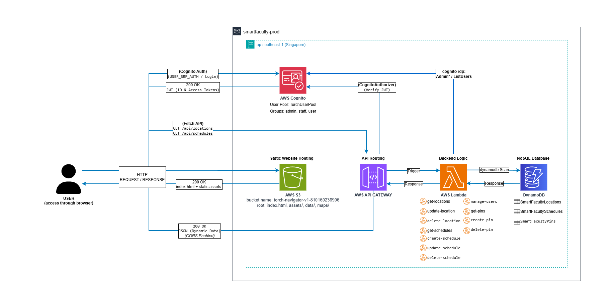

<div align="center">


# Perimeter (V4)

**ระบบแผนที่นำทางภายในอาคารอัจฉริยะ ค้นหาตารางเรียน-สอบ และจัดการทางปิดชั่วคราว คณะวิทยาศาสตร์และเทคโนโลยี (CS333 / CS361)**

</div>

ยินดีต้อนรับสู่พื้นที่พัฒนาของ **Perimeter** ระบบแผนที่นำทางภายในอาคารอัจฉริยะสำหรับคณะวิทยาศาสตร์และเทคโนโลยี มหาวิทยาลัยธรรมศาสตร์ ศูนย์รังสิต อาคารบรรยายรวม 3 (LC-3 หรือ บร.3)

เอกสารฉบับนี้สรุปภาพรวมสถาปัตยกรรม V4, ระบบสิทธิ์ผู้ใช้งาน (RBAC), แผนผังเส้นทาง, ความสามารถใหม่ในเวอร์ชัน V4 (ระบบนำทางหาเส้นทางเดินสั้นที่สุด, การค้นหาห้องสอบ, การจัดการทางปิดชั่วคราว และการรองรับ Scale) รวมถึงขั้นตอนการติดตั้งและรัน Sandbox ส่วนตัวบน AWS

---

## Live Demo & Core Features

[Live Demo (Production บน AWS S3)](http://torch-v2-site-287785301136.s3-website-ap-southeast-1.amazonaws.com/)
*(หมายเหตุ: Production S3 Bucket โฮสต์ภายใต้ชื่อ `torch-v2-site-287785301136` ตาม CloudFormation Stack ดั้งเดิม)*

### ฟีเจอร์หลักในระบบ (V4)
1. **Interactive 2D SVG & 3D Floor Map:** แผนที่ผังอาคาร 2D SVG แบบ Interactive ซูม/เลื่อนและเลือกห้องเป้าหมายได้อิสระ พร้อมมุมมอง 3D Floor Plan (Three.js WebGL) ครบทั้ง 4 ชั้นของอาคาร LC-3 พร้อมกลไก Fallback กลับสู่ 2D อัตโนมัติเมื่ออุปกรณ์ไม่รองรับ WebGL
2. **Indoor Navigation & Shortest-Path Routing (V4):** ระบบคำนวณและวาดเส้นทางเดินนำทางจริงจากจุดเริ่มต้นไปยังห้องเป้าหมาย ผ่านอัลกอริทึม Dijkstra ข้ามชั้นผ่านบันได และคำนวณหลีกเลี่ยงทางเดินหรือห้องที่ปิดชั่วคราวโดยอัตโนมัติ *(V4 Planned)*
3. **Exam & Schedule Search (V4):** ระบบค้นหาห้องเรียนและห้องสอบ ค้นหาด้วยรหัสวิชา (เช่น `CS361`, `BAS350`) วันและเวลาสอบ แล้วแสดงห้อง พิกัดชั้น และปุ่มกดเริ่มนำทางไปยังห้องสอบได้ทันที
4. **Temporary Closures Management (V4):** เจ้าหน้าที่สามารถกำหนดสถานะ "ปิดปรับปรุง/ปิดชั่วคราว" สำหรับห้องเรียนและเส้นทางเดิน พร้อมระบุช่วงเวลา (`closed_from` ถึง `closed_until`) และเหตุผลผ่านหน้า `/staff` โดยระบบจะแสดงป้ายเตือนบนแผนที่และเลี่ยงเส้นทางนั้นในการนำทางแบบ Real-time *(V4 Planned)*
5. **My Schedule & Calendar Sync:** ผู้ใช้งานที่เข้าสู่ระบบสามารถบันทึก (Pin) คาบเรียนหรือการสอบเก็บไว้ในตารางส่วนตัว ส่งออกไฟล์ปฏิทินมาตรฐาน `.ics` (พร้อมกฎ Recurrence ตลอดภาคการศึกษา) หรือกดปุ่มซิงก์เข้า Google Calendar ได้ในคลิกเดียว (GIS Token Flow)
6. **Web-based Room & Schedule Editor (`/staff`):** หน้าเว็บสำหรับเจ้าหน้าที่และผู้ดูแลระบบในการจัดการข้อมูลห้องเรียน ปรับปรุงตารางการใช้งาน และกำหนดทางปิดชั่วคราว
7. **Unified Authentication & User Administration (`/login`, `/admin`):** ระบบยืนยันตัวตนผ่าน AWS Cognito User Pool รองรับการเปลี่ยนรหัสผ่านในการเข้าใช้งานครั้งแรก (`NEW_PASSWORD_REQUIRED`) พร้อมแผงควบคุมสิทธิ์และจัดการผู้ใช้สำหรับ Admin

---

## Architecture & Tech Stack



> [!NOTE]
> **สถานะสถาปัตยกรรม:** ปัจจุบันระบบที่ Deploy ใช้งานจริงบน Cloud ยังคงรันอยู่บนโครงสร้างสถาปัตยกรรม V3 (ตามภาพผังข้างต้น) สำหรับแผนผังสถาปัตยกรรมเป้าหมาย **Perimeter V4** ที่กำลังพัฒนาใน Milestone นี้ (เพิ่ม Lambda `get-graph`, `get-route`, `update-closure` และตาราง `SmartFacultyGraph`) สามารถดูได้ที่ [docs/Perimeter_V4_architecture.drawio.png](docs/Perimeter_V4_architecture.drawio.png) (และไฟล์ต้นฉบับ [docs/Perimeter_V4_architecture.drawio](docs/Perimeter_V4_architecture.drawio))

- **Frontend Client:** React 18, Vite, TypeScript, Tailwind CSS, Three.js (`@react-three/fiber`, `@react-three/drei`), Phosphor Icons (โฮสต์บน AWS S3 Static Website)
- **Authentication & RBAC:** AWS Cognito User Pool (`admin`, `staff`, `user` groups — CloudFormation Identifier: `TorchUserPool`) ควบคุมการเข้าถึงด้วย JSON Web Tokens (IdToken / AccessToken)
- **Compute & API:** AWS Lambda (Node.js 24.x) บน Implicit API Gateway พร้อม Cognito User Pool Authorizer บนเส้นทางเขียนและข้อมูลส่วนบุคคล
- **Databases (Amazon DynamoDB On-Demand):**
  - `SmartFacultyLocations`: ข้อมูลพิกัดห้อง ผังอาคาร หมวดหมู่ และความจุห้อง (PK: `location_id`)
  - `SmartFacultySchedules`: ข้อมูลตารางเรียน รอบการสอบ และผู้สอน (PK: `room_code`, SK: `schedule_slot`)
  - `SmartFacultyPins`: ข้อมูลการบันทึกตารางเรียนส่วนบุคคลของผู้ใช้ (PK: `user_id`, SK: `room_code#schedule_slot`)
  - `SmartFacultyGraph` *(V4 Planned)*: ข้อมูลโครงสร้างกราฟทางเดิน LC3 ทั้งหมด (Nodes, Edges) และสถานะการปิดทางชั่วคราว (PK: `graph_id`, SK: `element_id`)
- **Infrastructure as Code (IaC):** AWS SAM (`template.yaml`), `samconfig.toml` — บริหารจัดการตามหลัก **No ClickOps**
- **Data Extractor & Tooling:** Node.js Scripts สำหรับสกัดข้อมูลผัง SVG, สร้างกราฟทางเดิน, ตรวจสอบความถูกต้อง (Seed Validator) และซิงก์ Environment Variables
- **CI/CD Pipeline:** GitHub Actions ตรวจสอบ Lint, Vitest, Lambda Tests, Automated Pre-gzip Asset Compression และ Deploy ขึ้น Production เมื่อ Merge เข้า `main`

### Request Path & Data Flow
1. **Public Read Routes:** การเรียกดูผังห้อง (`GET /api/locations`), ตารางเรียน (`GET /api/schedules`), กราฟทางเดิน (`GET /api/graph` [planned]), และการคำนวณเส้นทางเดิน (`GET /api/route` [planned]) ส่งผ่าน API Gateway ไปยัง Lambda ได้โดยตรงโดยไม่ต้องล็อกอิน มีการแคชผลลัพธ์เพื่อรองรับโหลดสูง
2. **Personal Schedule Routes (`My Schedule`):** การอ่านและบันทึกตารางส่วนตัว (`GET`, `POST`, `DELETE /api/pins`) เบราว์เซอร์จะแนบ Cognito `IdToken` ใน Header `Authorization` โดย API Gateway ตรวจสอบความถูกต้องของ Token และ Lambda ใช้ค่า `claims.sub` แยกข้อมูลเฉพาะของผู้ใช้แต่ละคน
3. **Role-Protected Write Routes (`Staff & Admin`):** การแก้ไขข้อมูลห้อง ตารางสอน การจัดการผู้ใช้ (`/api/users`) และการบันทึกทางปิดชั่วคราว (`PUT /api/graph/closures` [planned]) จะถูกตรวจสอบความถูกต้องของ Token ที่ API Gateway และตรวจสอบกลุ่มสิทธิ์ (`cognito:groups`) ซ้ำที่ Lambda Handler เพื่อป้องกัน Privilege Escalation

### Environments

| Environment | Account | Region | Who Deploys | Lifetime | Credentials |
| :-- | :-- | :-- | :-- | :-- | :-- |
| **Dev** | AWS Academy Learner Lab | `us-east-1` | Teammate (Local via `sam deploy --config-env dev`) | ชั่วคราว (~4 ชั่วโมง) | Session Token ชั่วคราวจาก Lab |
| **Prod** | AWS Account (Free Tier) | `ap-southeast-1` | GitHub Actions CI/CD (`sam deploy --config-env prod`) | ถาวร | GitHub OIDC Role (Least-privilege) |

> [!IMPORTANT]
> **Production Seeding & Deployment:** ดำเนินการผ่าน GitHub Actions CD Pipeline เท่านั้น บัญชี Production ไม่อนุญาตให้ใช้ Static Access Keys หรือส่งคำสั่งแก้ข้อมูลจาก Local Dev โดยตรง

---

## Developer Quickstart (วิธีรันและทดสอบระบบ)

โปรเจกต์นี้ทำงานแบบ Serverless เพื่อไม่ให้กวน Production ทีมงานทุกคนต้องสร้าง Sandbox บนบัญชี AWS Academy ของตนเองก่อนเริ่มพัฒนา

### 1. Pre-requisites (สิ่งที่ต้องมี)
- ติดตั้ง **Node.js** (v24 แนะนำ), **AWS CLI** และ **AWS SAM CLI** ในเครื่อง
- **ข้อควรระวัง:** เซสชัน AWS Academy Learner Lab หมดอายุทุก 4 ชั่วโมง เมื่อเปิด Lab ใหม่ ให้คัดลอก Credentials ล่าสุดมาตั้งค่าใน Terminal เสมอ

### 2. The "Magic" Command
เมื่อตั้งค่า AWS Credentials ใน Terminal เรียบร้อยแล้ว ให้เปิดที่โฟลเดอร์ Root ของโปรเจกต์ แล้วรันคำสั่งเดียวนี้:
```bash
npm run bootstrap
```

**คำสั่ง `npm run bootstrap` ทำอะไรให้บ้าง?**
1. `sam build & deploy`: สร้าง CloudFormation Stack (Lambda, API Gateway, DynamoDB ตารางหลัก, Cognito User Pool, S3 Bucket)
2. `seed`: นำเข้าข้อมูลผังห้องและตารางเรียน-สอบเข้าสู่ DynamoDB
3. `env:pull`: ดึงค่า CloudFormation Stack Outputs (`ApiUrl`, `UserPoolId`, `UserPoolClientId` ฯลฯ) มาเขียนลง `frontend/.env.local` ให้อัตโนมัติ
4. `site:publish`: ทำการ Build และ Publish ไฟล์หน้าเว็บขึ้น S3 Bucket ของคุณทันที

### 3. Cheat Sheet (คำสั่งที่ใช้บ่อย)

| งานที่ต้องการทำ | คำสั่งที่ใช้ |
| :--- | :--- |
| **รันเว็บในเครื่องสำหรับพัฒนา (Local Dev)** | `npm run dev` (หรือ `npm --prefix frontend run dev`) |
| **ทดสอบเว็บบนมือถือผ่าน Wi-Fi เดียวกัน** | `npm --prefix frontend run dev -- --host` (เปิดผ่าน IP ที่ Terminal แจ้ง) |
| **อัปเดต Backend / Lambda / SAM Stack** | `npm run deploy` (หรือ `npm run bootstrap`) |
| **ดึงค่า Config ล่าสุดจาก AWS ลง `.env.local`** | `npm run env:pull` |
| **นำเข้าข้อมูลตั้งต้น (Locations, Schedules)** | `npm run seed` |
| **สร้างบัญชีผู้ใช้ตัวอย่าง (Admin / Staff / User)** | `npm run seed:users` |
| **Build และอัปโหลดเฉพาะหน้าเว็บขึ้น S3** | `npm run site:publish` |
| **ตรวจนับจำนวนข้อมูลและ Health Check ของ Stack** | `npm run verify` |
| **ทดสอบความถูกต้องของ Verify Script** | `npm run test:verify` |
| **ลบระบบ Sandbox ทั้งหมด (Clean up)** | รัน `npm run site:empty` แล้วตามด้วย `sam delete --config-env dev` |

> [!IMPORTANT]
> ต้องรัน `npm run site:empty` เพื่อล้างไฟล์ใน S3 Bucket ก่อนสั่ง `sam delete` เสมอ มิฉะนั้น CloudFormation จะลบ Bucket ไม่สำเร็จ

---

## Routes, Authentication & Role Matrix

### แผนผังเส้นทางหน้าเว็บ (Application Routes)

| Route | หน้าที่การใช้งาน | สิทธิ์การเข้าถึง |
| :--- | :--- | :--- |
| `/` | หน้า Landing Page แสดงภาพรวมระบบ ข้อมูลอาคาร และปุ่มลัดเข้าสู่แผนที่หรือหน้าลงชื่อเข้าใช้ | ทุกคน (Public) |
| `/login` | หน้าเข้าสู่ระบบกลาง (Unified Sign-In) และหน้าบังคับตั้งรหัสผ่านใหม่ในการเข้าใช้งานครั้งแรก (`NEW_PASSWORD_REQUIRED`) | ทุกคน (Public) |
| `/map` | หน้าแผนที่นำทางหลัก (2D SVG / 3D Floor Plan), ค้นหาห้องและรอบสอบ, คำนวณเส้นทางเดิน (Route), ดูสถานะทางปิด และแผงตารางเรียนส่วนตัว (My Schedule) | ทุกคน (Public อ่าน/นำทางได้; สมาชิก Login เพื่อบันทึก Pin) |
| `/staff` | แผงควบคุมสำหรับเจ้าหน้าที่ (Room & Schedule Editor) และระบบตั้งค่าทางปิดชั่วคราว (Temporary Closures Panel) | เฉพาะกลุ่ม `staff` และ `admin` (ผู้ที่ยังไม่ล็อกอินจะถูกส่งไป `/login?redirect=/staff`) |
| `/admin` | แผงควบคุมระบบจัดการผู้ใช้ (สร้างผู้ใช้, กำหนดบทบาท, รีเซ็ตรหัสผ่าน, ลบบัญชีผู้ใช้) | เฉพาะกลุ่ม `admin` เท่านั้น |

### ระดับบทบาทและสิทธิ์การเข้าถึง (Role Matrix)

| Role | Cognito Group | สิทธิ์การเข้าถึง API (API Permissions) | หน้าจอที่เข้าถึงได้และหน้าเริ่มต้นหลัง Login |
| :--- | :--- | :--- | :--- |
| **Admin** | `admin` | Full Access: อ่าน/เขียน/แก้ไข/ลบ ข้อมูลห้อง ตารางเรียน ทางปิดชั่วคราว (`POST`, `PUT`, `DELETE`), จัดการ Pin ของตนเอง และจัดการบัญชีผู้ใช้ทั้งหมด (`/api/users`) | เข้าถึงได้ทุกหน้า (`/map`, `/staff`, `/admin` พร้อม Danger Zone) — หน้าเริ่มต้น: `/admin` |
| **Staff** | `staff` | Edit & Closure Access: อ่าน สร้าง และแก้ไขข้อมูลห้องและตารางเรียน (`POST`, `PUT`), จัดการสถานะทางปิดชั่วคราว (`PUT /api/graph/closures` [planned]) และจัดการ Pin ตนเอง; **ไม่อนุญาตให้ลบข้อมูลหลักหรือจัดการบัญชีผู้ใช้** (`DELETE` &rarr; `403 Forbidden`) | เข้าถึง `/map`, `/staff` (ซ่อนปุ่มลบถาวรและเมนู Admin) — หน้าเริ่มต้น: `/staff` |
| **User** | `user` | Personal Schedule Access: ดูแผนที่ ตารางเรียน รอบสอบ และเส้นทางเดินสาธารณะ จัดการตารางเรียนส่วนตัว (`GET`, `POST`, `DELETE /api/pins`); เรียก API แก้ไขข้อมูลส่วนกลาง &rarr; `403 Forbidden` | เข้าถึง `/map` และแผง My Schedule — หน้าเริ่มต้น: `/map` |
| **Guest** | *(ไม่มี Token)* | Read Only & Navigation: เข้าใช้งานแผนที่ 2D/3D ค้นหารอบสอบ คำนวณเส้นทางเดิน (`GET /api/locations`, `/api/schedules`, `/api/graph` [planned], `/api/route` [planned]); เรียก API เขียนหรือ `/api/pins` &rarr; `401 Unauthorized` | เข้าถึง `/` และ `/map` (เมื่อกด Pin ระบบจะนำทางไป `/login`) |

### การสร้าง Demo Accounts
สร้างบัญชีทดสอบในแต่ละบทบาทผ่าน Environment Variables (ห้ามบันทึกรหัสผ่านลงในโค้ด):

**Bash / macOS / Linux:**
```bash
ADMIN_PASSWORD="<YourAdminPassword>" STAFF_PASSWORD="<YourStaffPassword>" USER_PASSWORD="<YourUserPassword>" npm run seed:users
```

**PowerShell (Windows):**
```powershell
$env:ADMIN_PASSWORD="<YourAdminPassword>"
$env:STAFF_PASSWORD="<YourStaffPassword>"
$env:USER_PASSWORD="<YourUserPassword>"
npm run seed:users
```

---

## ฟีเจอร์และความสามารถใหม่ใน V4 (V4 Capabilities)

### 1. Indoor Navigation & Dijkstra Shortest Path
- การคำนวณเส้นทางเดินทำที่ฝั่ง Server ผ่าน Lambda `functions/get-route/` (`GET /api/route?from=<id>&to=<id>&at=<ISO>` [planned]) เพื่อให้ผลลัพธ์สอดคล้องกันทุกอุปกรณ์ และสะท้อนสถานะทางปิดล่าสุด
- รองรับการเดินข้ามชั้นผ่านโหนดบันได (`Connecting Stairs`) พร้อมแสดงระยะทางรวม (Distance) และจุดเลี้ยวบนแผนที่แบบ Real-time
- หากเส้นทางหลักติดทางปิด ระบบจะเลือกเดินอ้อมเส้นทางอื่นโดยอัตโนมัติ

### 2. Exam Search & Wayfinding
- ค้นหารอบการสอบจากรหัสวิชา (เช่น `BAS 350`) และช่วงเวลาสอบ
- แสดงการ์ดผลลัพธ์ระบุวัน เวลาสอบ รหัสห้อง และชั้นอย่างชัดเจน พร้อมปุ่ม "นำทางไปห้องสอบ" ที่เชื่อมต่อกับระบบ Navigation ทันที

### 3. Temporary Closures Management
- เจ้าหน้าที่สามารถกำหนดช่วงเวลาปิดปรับปรุง (`closed_from` ถึง `closed_until`) สำหรับห้องเรียนหรือทางเดินบางช่วงผ่านหน้า `/staff`
- บันทึกข้อมูลลงตาราง `SmartFacultyGraph` อย่างปลอดภัยด้วย `ConditionExpression` และเก็บบันทึก `closed_by` เพื่อความโปร่งใส
- แผนที่แสดงสถานะห้องที่ปิดชั่วคราวบน Marker และ Modal พร้อมเหตุผล

### 4. Scale & High Availability Readiness
- มีการจัดสถาปัตยกรรมรองรับโหลดอ่านจำนวนมากในช่วงเปิดภาคการศึกษาและสัปดาห์สอบ
- รองรับการตั้งค่า API Gateway Method Throttling, Lambda Reserved Concurrency และ In-memory Caching เพื่อป้องกัน Cold Start ซ้ำซ้อน
- ผลการทดสอบโหลดของระบบยังอยู่ระหว่างดำเนินการ ดูความคืบหน้าได้ที่ Issue #150

---

## Frontend Environment Variables & Pipeline Parity

เมื่อ Frontend ต้องใช้ค่า Config จาก CloudFormation Stack ระบบใช้หลักการ **Four-Point Sync** เพื่อให้ Local Dev และ Production ทำงานสอดคล้องกันเสมอ:
1. **`template.yaml` (`Outputs`):** ส่งออกค่า `ApiUrl`, `UserPoolId`, `UserPoolClientId`, `SiteBucketName`, `LocationsTableName`, `SchedulesTableName`, `PinsTableName`, `GraphTableName` (planned)
2. **`scripts/write-env.mjs` (`npm run env:pull`):** ดึงค่าจาก Stack มาเขียนลง `frontend/.env.local` (`VITE_API_BASE_URL`, `VITE_COGNITO_USER_POOL_ID`, `VITE_COGNITO_CLIENT_ID`)
3. **`.github/workflows/cd-frontend.yml`:** ดึงค่า Outputs เดียวกันในขั้นตอน Build ก่อนอัปโหลดขึ้น S3 Production
4. **`frontend/.env.example`:** เก็บโครงสร้างตัวแปรตัวอย่างสำหรับนักพัฒนา

---

## Domain Glossary & AI Agent Playbook

โปรเจกต์นี้ใช้แบบแผน Domain Modeling และ Agent Skills ตามแนวทางของ Matt Pocock:
- **`CONTEXT.md` (ที่ Root):** คลังนิยามคำศัพท์โดเมนระบบ Perimeter เช่น `Location`, `Room`, `Schedule Slot`, `Event`, `Exam`, `Pin`, `Role`, `Route`, `Graph Node/Edge`, `Closure`, `Availability Window` (ห้ามเบี่ยงเบนไปใช้คำศัพท์ต้องห้ามที่ระบุไว้)
- **`docs/adr/`:** บันทึกการตัดสินใจทางสถาปัตยกรรมที่สำคัญ เช่น [ADR 0001: Dedicated DynamoDB Table for Routing Graph and Closures](docs/adr/0001-separate-graph-table.md)
- **Agent Commands:** สามารถเรียกใช้ Agent Skills ในการพัฒนาได้ เช่น `/grill-with-docs`, `/to-spec`, `/tdd`, `/implement`, และ `/code-review`

---

## Testing & Quality Assurance

- **Frontend Unit & Logic Tests:** `npm test` (รันผ่าน `frontend/src/services/__tests__` และ `hooks/__tests__`)
- **Frontend UI & Component Tests:** `npm --prefix frontend run test:ui` (Vitest UI suite)
- **Frontend Code Quality & Linting:** `npm run lint`
- **Backend Lambda Tests:** `node --test functions/<name>/index.test.mjs`
- **IaC & SAM Template Validation:** `sam validate --lint`
- **Deployment Verification:** `npm run verify` และ `npm run test:verify`
- **Pull Request Review:** ก่อน Merge เข้าสู่ `main` ต้องผ่านการ Review จาก CodeRabbit และ Tech Lead พร้อมสถานะ Green CI เสมอ

---

## Acknowledgments
- The interactive SVG floor plans and initial map navigation nodes were originally adapted from the [ronnakrit303/CS232-Map_Navigation](https://github.com/ronnakrit303/CS232-Map_Navigation) repository.

---

## License
This project is licensed under the MIT License - see the [LICENSE](LICENSE) file for details. 

**Exceptions and Third-Party Assets:**
The MIT License applies only to the original source code and assets created for this repository. Third-party assets, specifically the interactive SVG floor plans and map navigation nodes adapted from the [ronnakrit303/CS232-Map_Navigation](https://github.com/ronnakrit303/CS232-Map_Navigation) repository, retain their original copyright. They are used here with permission for academic purposes and are EXCLUDED from this MIT License grant. Anyone wishing to redistribute or reuse those specific assets must obtain permission from their respective original authors.
