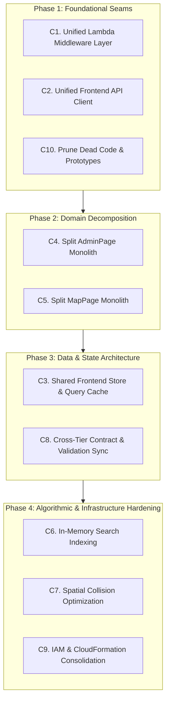

# Codebase Map and Refactor Candidates

> Issue #142. **This is a read-only survey.** No program code was changed. Every refactor and optimisation listed here is a *proposal* for a child issue, and the actual changes land in V6, not V4.
>
> Snapshot: `main` @ `5d79409` (after #161). Line numbers refer to that commit and drift as Wave 1 (#145–#148) lands.
>
> Vocabulary: domain terms come from [`CONTEXT.md`](../CONTEXT.md). Architecture terms (**module**, **interface**, **depth**, **seam**, **leverage**, **locality**) come from the `codebase-design` skill. A module is *shallow* when its interface is nearly as complex as its implementation.

## 1. Folder map

| Path | Role |
|---|---|
| `frontend/` | React 18 + Vite + TS + Tailwind + Three.js client. Own `package.json`. |
| `frontend/src/main.tsx` | Entry point. Mounts `BrowserRouter` → `PinsProvider` → routes. |
| `frontend/src/components/` | Page-level modules (`MapPage`, `AdminPage`, `AdminManagementPage`, `LandingPage`, `LoginPage`) plus UI pieces (`TopBar`, `SearchBar`, `SearchResultList`, `MyScheduleDrawer`, `WeeklyTimetable`, `PinButton`, `RouteGuard`, …). |
| `frontend/src/components/map/` | The 2D SVG and 3D (Three.js) map: `MapContainer` (lazy-loads `MapContainer3D`), `MapContainer2D`, `FloorPlanSvg`, `RoomMarkers`, `createMapScene`, `floorConfig`, `modelCoordinates`, `roomAreaGeometry`. |
| `frontend/src/services/` | Non-React modules. HTTP clients (`roomsService`, `schedulesService`, `pinsService`, `adminService`, `adminUserService`), auth (`authService`, `authRouting`), pure logic (`filterRooms`, `roomSearch`, `markerLayout`, `timetableLayout`, `scheduleDisplay`, `roomDisplay`), calendar (`calendarExport`, `googleCalendarSync`). |
| `frontend/src/hooks/` | `useRooms`, `useSchedules`, `useRoomSchedules`, `usePins`, `useIsDesktop`, `usePreloadImages`. |
| `frontend/src/context/` | `PinsProvider` and `pinsContextDef`. The only React context in the app. |
| `frontend/src/types/` | `room`, `schedule`, `pin`, `auth` types. |
| `frontend/src/prototype/` | Old prototype pages with **no production importer**. Removal is tracked in #141. |
| `functions/<name>/` | 13 Lambda handlers, each with its own `package.json` and `index.test.mjs`. `get-route` also has `route.mjs`, the Dijkstra router. |
| `template.yaml` | The whole AWS SAM stack: tables, Cognito, S3 site bucket, 13 functions, 13 IAM roles, outputs. |
| `scripts/` | Stack tooling: `bootstrap`, `seed`, `verify`, `write-env`, `publish-site`, `empty-site-bucket`, `lib/`. |
| `tools/` | Data extraction and seed data (`data-extraction/lc3/`), plus `create-demo-users.mjs`. |
| `assets/3d/lc3/` | Blender sources and Python/Node scripts that produce `lc3-campus.glb`. |
| `docs/` | Architecture diagrams, ADRs (`adr/0001-separate-graph-table.md`), agent docs. |
| `.github/workflows/` | `ci.yml`, `cd-backend.yml`, `cd-frontend.yml`. |

## 2. How the app fits together

### 2.1 Routes (`frontend/src/main.tsx`)

| Route | Page module | Guard |
|---|---|---|
| `/` | `LandingPage` | none |
| `/login` | `LoginPage` | none (uses `authRouting.resolvePostLoginRedirect`) |
| `/map` | `MapPage` | none (**Guest** can read) |
| `/staff` | `AdminPage` | `RouteGuard allowedRoles=['staff','admin']` |
| `/admin` | `AdminManagementPage` | `RouteGuard allowedRoles=['admin']` |
| `/prototype/map` | redirect to `/map` | leftover, see #141 |

`RouteGuard` calls `checkSession` / `getUserRole` / `signOut` (`authService`) and `getHomeRouteForRole` / `sanitizeRedirectPath` (`authRouting`).

### 2.2 Data flow per feature

Browser → `services/*.ts` → API Gateway → Lambda → DynamoDB. Every client module builds its URL from `VITE_API_BASE_URL`.

| Feature | Frontend chain | Endpoint | Lambda | Table |
|---|---|---|---|---|
| Room list (map, landing, staff) | `MapPage` → `useRooms` → `roomsService.getRooms` | `GET /api/locations` | `get-locations` (Scan) | `SmartFacultyLocations` |
| All schedules (search) | `MapPage` → `useSchedules` → `schedulesService.getSchedules` | `GET /api/schedules` | `get-schedules` (Scan) | `SmartFacultySchedules` |
| One room's timetable | `MapPage` → `useRoomSchedules(selectedRoom.code)` → `getSchedules` | `GET /api/schedules?room_code=` | `get-schedules` (Query) | `SmartFacultySchedules` |
| Pin a slot | `PinButton` → `usePins` → `PinsProvider` → `pinsService.createPin` | `POST /api/pins` | `create-pin` | `SmartFacultyPins` |
| My Schedule | `MyScheduleDrawer` → `usePins` → `pinsService.getPins` / `deletePin` | `GET /api/pins`, `DELETE /api/pins/{room_code}/{schedule_slot}` | `get-pins`, `delete-pin` | `SmartFacultyPins` |
| Calendar export | `MyScheduleDrawer` / `MapPage` → `calendarExport`; sync via `googleCalendarSync` | Google Calendar API (no Lambda) | none | none |
| Edit room | `AdminPage` → `adminService.updateRoom` / `deleteRoom` | `PUT` / `DELETE /api/locations/{location_id}` | `update-location`, `delete-location` | Locations (+ Schedules on delete) |
| Edit schedule | `AdminPage` → `adminService.createSchedule` / `updateSchedule` / `deleteSchedule` | `POST /api/schedules`, `PUT` / `DELETE /api/schedules/{room_code}/{schedule_slot}` | `create-schedule`, `update-schedule`, `delete-schedule` | Schedules (+ Locations read on update) |
| Manage users | `AdminManagementPage` → `adminUserService` | `GET`/`POST /api/admin/users`, `PUT`/`DELETE /api/admin/users/{username}` | `manage-users` | Cognito `TorchUserPool` |
| Routing graph | none yet (planned for #145) | `GET /api/graph`, `GET /api/route?from&to&at` | `get-graph`, `get-route` | `SmartFacultyGraph` |

Worked example for the issue's `MapPage` → `useRooms` → `roomsService` → `get-locations` chain:

1. `MapPage.tsx` L303 calls `useRooms()`.
2. `useRooms.ts` reads a `localStorage` copy (`torch_rooms_cache_v1`) so the map paints at once, then calls `getRooms()` and refetches on window `focus`.
3. `roomsService.getRooms` (L49) fetches `${VITE_API_BASE_URL}/api/locations` with `cache: 'no-store'` and normalises each record.
4. API Gateway routes it to `GetLocationsFunction` (`template.yaml` L189), whose handler `functions/get-locations/index.mjs` runs a paginated `Scan` of `SmartFacultyLocations` and returns `{ count, records }`.

The **Route** feature is built on the server only. `GET /api/route` loads the whole graph with one Query loop, caches it in the Lambda for 30 s (`DEFAULT_CACHE_TTL_MS` in `functions/get-route/index.mjs`), and runs `findRoute` from `route.mjs`.

### 2.3 Lambda ↔ route ↔ table ↔ IAM (from `template.yaml`)

All write and admin routes use the default `CognitoAuthorizer`. Routes with `Authorizer: NONE` are public. Each function declares a dedicated `…Role` (created only outside Learner Lab) **and** a `Policies:` block or a role override, so permissions are defined in two places.

| Function (L) | Route | Auth | Table(s) | Actions granted to the role (`…Role`) |
|---|---|---|---|---|
| `GetLocationsFunction` (189) | `GET /api/locations` | public | Locations | `Scan` |
| `UpdateLocationFunction` (167) | `PUT /api/locations/{location_id}` | Cognito + staff/admin check in code | Locations | `GetItem, PutItem, UpdateItem, DeleteItem, Query, Scan`; policy `DynamoDBCrudPolicy` |
| `DeleteLocationFunction` (331) | `DELETE /api/locations/{location_id}` | Cognito + group check | Locations, Schedules | Locations `GetItem, DeleteItem`; Schedules `Query, DeleteItem, BatchWriteItem` |
| `GetSchedulesFunction` (262) | `GET /api/schedules` | public | Schedules | `Query, Scan` |
| `CreateScheduleFunction` (373) | `POST /api/schedules` | Cognito + group check | Schedules | `PutItem` |
| `UpdateScheduleFunction` (423) | `PUT /api/schedules/{room_code}/{schedule_slot}` | Cognito + group check | Schedules, Locations | Schedules `UpdateItem, GetItem, PutItem, DeleteItem`; Locations `GetItem` |
| `DeleteScheduleFunction` (465) | `DELETE /api/schedules/{room_code}/{schedule_slot}` | Cognito + group check | Schedules | `DeleteItem` |
| `ManageUsersFunction` (614) | `GET`/`POST /api/admin/users`, `PUT`/`DELETE /api/admin/users/{username}` | Cognito + admin check | Cognito pool | 9 `cognito-idp:*` actions (L629–L638) |
| `GetPinsFunction` (707) | `GET /api/pins` | Cognito (`sub` from claims) | Pins | `Query` |
| `CreatePinFunction` (753) | `POST /api/pins` | Cognito (`sub` from claims) | Pins | `PutItem` |
| `DeletePinFunction` (799) | `DELETE /api/pins/{room_code}/{schedule_slot}` | Cognito | Pins | `DeleteItem` |
| `GetGraphFunction` (866) | `GET /api/graph` | public | Graph | `Query` |
| `GetRouteFunction` (926) | `GET /api/route` | public | Graph | `Query` |

Planned for #147: `/api/graph/closures` (protected).

## 3. Findings

Evidence is a file and line you can open. Items I could not confirm by reading the code are marked *(unverified)*.

### 3.1 Duplicated code

| Duplicate | Where | Count |
|---|---|---|
| `CORS_HEADERS` constant | every `functions/*/index.mjs` (e.g. `update-location` L9, `get-locations` L9) | 13 copies |
| `getCallerGroups(event)` | `create-schedule` L16, `delete-location` L17, `delete-schedule` L16, `update-location` L16, `update-schedule` L20, `manage-users` L25 | 6 copies |
| `getCallerIdentity(event)` | `create-schedule` L27, `update-location` L27, `update-schedule` L31 | 3 copies |
| `DynamoDBClient` + `DynamoDBDocumentClient.from` boilerplate | all 12 DynamoDB functions (lines 4–5) | 12 copies |
| `isValidEventDate` | `create-schedule`, `update-schedule` (exported from both) and `AdminPage.tsx` L143 | 3 copies, 2 languages |
| `API_BASE_URL` constant | `roomsService` L45, `schedulesService` L26, `pinsService` L4, `adminService` L11, `adminUserService` L10 | 5 copies |
| `authHeaders` (read token, build `Authorization`) | `adminService` L14, `adminUserService` L13, `pinsService` L29 | 3 copies |
| `RoomCategoryBadge` component | `AdminPage.tsx` L112, `MapPage.tsx` L60 | 2 copies |
| `FLOOR_PLAN_ASSETS = FLOOR_CONFIGS.map(...)` | `AdminPage.tsx` L70, `MapPage.tsx` L58 | 2 copies |
| IAM: separate `…Role` and function `Policies:` | `template.yaml`, 13 pairs | permissions can drift, e.g. `UpdateLocationRole` (L153–L164) grants six actions while the handler imports only `UpdateCommand` |

### 3.2 Large multi-purpose files

| File | Lines | Contents |
|---|---|---|
| `AdminPage.tsx` | 1,781 | 9 inline modules: `RoomCategoryBadge`, event-date helpers, `EventDateField`, `EventTypeBadge`, `AdminSearchBox`, `RoomListItem`, `ScheduleRow` (L351–L589), `CreateScheduleForm` (L590–L768), `RoomEditPanel` (L769–L1199, ~430 lines), `AllSchedulesView`, then `AdminPage` itself (L1363+) with 42 `useState` and 12 `useMemo`/`useCallback` calls. |
| `AdminManagementPage.tsx` | 970 | `RoleGooeyDropdown` plus a page with 19 `useState`. |
| `MapPage.tsx` | 878 | `RoomCategoryBadge`, `RoomDetailContent` (L85–L295, ~210 lines) and `MapPage` (L296+) importing 23 modules, the highest fan-out in the app. |
| `createMapScene.ts` | 717 | Three.js scene construction. |
| `functions/manage-users/index.mjs` | 500 | One handler for four routes. |
| `functions/get-route/route.mjs` | 436 | Heap, graph build, Dijkstra, closure-avoidance loop. Cohesive, but dense. |

These files are the ones Wave 1 edits: #145 (navigation UI → `MapPage`), #146 and #148 (search → `filterRooms`, `MapPage`), #147 (closure tab → `AdminPage`, new Lambdas).

### 3.3 Unused or dead code

| Item | Evidence | Note |
|---|---|---|
| `frontend/src/prototype/*` (`PrototypeLanding`, `PrototypeMap`, `PrototypeSwitcher`, ~450 lines) | no importer outside `prototype/` (`git grep`) | Already handled by #141. The `/prototype/map` redirect in `main.tsx` L27–L28 goes with it. |
| `components/map/MapLegend.tsx` | referenced only by its own test | **Not covered by #141.** Candidate for deletion. |
| `components/RoomSearchPanel.tsx` | referenced only by its own test | **Not covered by #141.** `MapPage` now builds the same search UI inline (`filterRooms` call at `MapPage.tsx` L359 vs `RoomSearchPanel.tsx` L58). Candidate for deletion. |
| Exports used only by tests | e.g. `authService`: `parseJwtPayload`, `saveSession`, `getUser`, `isAuthenticated`, `hasRole`, `isStaff`, `isUser`; `authRouting.isPathAllowedForRole`; `calendarExport.formatEventMetadata`, `getEventUid`; `markerLayout.getMarkerPriority`, `estimateLabelWidth`; `roomSearch.roomMatchRank`; `timetableLayout.parseTimeToMinutes`, `normalizeDay` | Many of these are exported **for testing**, so they are not necessarily dead. Needs a human decision per item. |
| Test-only `*_ENDPOINT` and `normalize*` exports | `roomsService`, `schedulesService`, `pinsService` | Same caveat. |
| `perimeter_icon.png` | used by `index.html` L5 only | Not dead. |

I did **not** find unused Lambdas or unrouted functions: every `functions/*` directory has a matching event in `template.yaml`.

### 3.4 Shallow modules (deletion test)

- **Service clients**: `adminService`, `adminUserService`, `pinsService` each re-implement base URL, auth header, `fetch`, and error parsing. Deleting any one would not concentrate complexity, it would push the same 10 lines to its callers, but the same lines also exist 3 times today. A single deep API-client module would give leverage to all five services.
- **Lambda handlers**: each handler's interface is a SAM event, but the *real* interface (CORS, group check, JSON body parsing, error envelope) is re-implemented per file, so there is no locality for fixes (e.g. changing the CORS policy touches 13 files).
- **`RoomSearchPanel`**: fails the deletion test, since deleting it removes nothing a caller uses.

### 3.5 Testing

- Lambdas expose `createHandler({ docClient, tableName })`, an injectable seam, and have a test per function. That is a good seam to keep.
- Page modules have tests (`__tests__/*.vitest.tsx`), but `AdminPage` at 1,781 lines is tested only through the whole page, so a change to `RoomEditPanel` has no focused test surface.
- Auth checks are re-implemented in six handlers, so six test files each re-cover the same behaviour.

## 4. Speed and time complexity

Observations only. Nothing here is a proposed V4 change and no measurements were taken, so treat the Big-O as a reading of the code, not a benchmark. *R* = rooms (131 per the comment in `get-locations/index.mjs`), *S* = schedule rows (count not measured), *V*/*E* = graph nodes/edges.

| Where | Cost | Assessment |
|---|---|---|
| `get-route/route.mjs` `runDijkstra` | binary heap, \(O((V+E)\log V)\) | **Good.** Correct data structure. |
| `route.mjs` closure-avoidance loop (L357) | up to 20 extra Dijkstra runs per request | Bounded by `searchLimit = 20`. Only matters if closures are many. |
| `route.mjs` `reconstructPath` (L139–L150) | `unshift` per node, \(O(L^2)\) in path length | Negligible for a building-sized path. |
| `route.mjs` `resolveNodes` (L112–L125) | two `filter` scans over *V* per request | Fine at this size. |
| `get-route` graph load | one Query loop + 30 s in-memory cache per warm container | **Good.** Cold start pays the Query. |
| `get-graph` | whole-partition Query on every request, no cache | Fine now, grows with the graph. |
| `get-locations` | full `Scan` on every request, \(O(R)\) | Fine at 131 items. The frontend masks latency with a `localStorage` cache. |
| `get-schedules` without `room_code` | full `Scan`, \(O(S)\), loaded by `MapPage` and `AdminPage` | Likely the biggest payload as *S* grows. Not cached on the frontend. |
| `useSchedules` / `useRooms` | refetch on every window `focus`; `useRooms` mounts in 4 pages, `useSchedules` in 3, each with its own state | Repeat fetches, no shared store. `useRooms` has a stale-while-revalidate cache; `useSchedules` has none. |
| `filterRooms` → `roomMatchesSchedule` (`filterRooms.ts` L191–L197) | for each room that fails the text match, scans all *S* schedules and re-runs `normalize` on room and schedule codes: worst case \(O(R \cdot S \cdot T)\) per query change | **Hot spot.** Runs inside `useMemo` in `MapPage` L359 on every query change. |
| `matchedSchedules` (`MapPage.tsx` L363) | second pass over *S* with the same terms | Duplicate work with the line above. |
| `markerLayout.layoutMarkers` (`isFree`, L133–L135) | for each candidate, `occupied.some` plus `[...anchors]` (copies the whole map): roughly \(O(R^2)\) with an \(O(R)\) allocation per check | **Hot spot.** Recomputed in `RoomMarkers.tsx` L191 when scale or selection changes. |
| `PinsProvider` | `pins.some` / `find` per lookup | Small *P*, negligible. |
| `delete-location` | Query + `BatchWriteItem` in chunks of 25 | **Good.** Handles pagination and unprocessed items. |

Summary: the backend algorithms are sound. The two frontend search/layout functions are the ones whose complexity is worth revisiting, and only if *S* or *R* grows.

## 5. Refactor candidates (ranked by long-term architectural impact for V6)

> **V6 Long-Term Scope Notice**: In accordance with the project roadmap, **no refactoring or code modifications are made in V4**. V4 focuses strictly on feature delivery and stability. Every candidate detailed below is an architectural proposal evaluated for **V6** implementation, ranked by its long-term systemic impact: Depth, Locality, Leverage, Big-O Scalability, and Maintainability.

The ranking prioritises architectural leverage across the entire system:
1. **Systemic Seams & Shared Infrastructure** (foundational layers affecting every service and handler)
2. **Core Domain & Data Management** (data fetching, state synchronisation, and client caching)
3. **Monolithic Component Decomposition** (separating entangled god-components into testable, deep modules)
4. **Algorithmic & Search Optimization** (replacing \(O(R \cdot S)\) brute-force scans with indexed lookups)
5. **Cross-Tier Validation & Infrastructure Hygiene** (schema synchronisation and dead code elimination)

---

### C1. Unified Lambda Middleware & Shared Backend Seam: **Strong (Highest Leverage)**

- **Long-Term Big Picture**: 
  Currently, 13 Lambda functions duplicate the fundamental mechanics of serverless execution: CORS headers (13 copies), JWT claims extraction (`getCallerGroups` in 6 files, `getCallerIdentity` in 3 files), error serialization envelopes, and DynamoDB document client instantiation (§3.1). Any systemic change (e.g. enhanced audit logging, revised CORS policy, token structure changes, or multi-tenant partition keys) requires touching 13+ distinct handler repositories.
- **Problem**: 
  Extreme dispersion of cross-cutting concerns. Handlers are shallow: substantial boilerplate wraps minimal DynamoDB operations, resulting in low locality and repetitive unit test mocks.
- **Target Architecture (V6)**: 
  Establish a shared Lambda layer or build-time internal utility module (e.g. `@perimeter/backend-core` or Lambda Layer) providing a deep interface:
  - `withAuth({ requiredRoles: ['staff', 'admin'] })(handler)`
  - Standardized response helpers: `ok(body)`, `badRequest(msg)`, `forbidden()`, `serverError(err)`
  - Pre-configured, reused AWS SDK DocumentClient instance
- **Leverage & Locality**: 
  **Massive leverage**. Adding or modifying a route in V6 becomes a concise, single-purpose handler focusing 100% on domain logic. Security patches and CORS configurations achieve complete locality in one shared module.
- **Impact on Testing**: 
  Eliminates repetitive testing of CORS headers and group parsing across 13 test suites. Unit tests for individual Lambdas only test domain branching and database commands.
- **Architectural Risk**: 
  Requires updating the build pipeline (`template.yaml` and `.github/workflows/cd-backend.yml`) to bundle the layer or build shared packages cleanly without violating the directory boundary rules in `AGENTS.md`.

---

### C2. Unified Frontend API Client & Request Pipeline: **Strong (High Systemic Value)**

- **Long-Term Big Picture**: 
  Across `roomsService`, `schedulesService`, `pinsService`, `adminService`, and `adminUserService`, the frontend repeatedly parses `VITE_API_BASE_URL` (5 times), extracts JWT bearer tokens from `authService` (3 times), manually invokes `fetch()`, and duplicates HTTP error response unwrapping (§3.1).
- **Problem**: 
  The network seam is completely fragmented. There is no centralized place to inject correlation IDs, manage global session expiration / 401 re-authentication triggers, handle network retries, or measure client-side latency.
- **Target Architecture (V6)**: 
  A deep `apiClient` module exposing an intuitive, typed interface:
  - `apiClient.get<T>(path, options)` / `apiClient.post<T>(path, body, options)`
  - Internal automatic JWT token attachment and session validation
  - Centralized error mapping (converting raw HTTP status codes to typed domain errors: `UnauthorizedError`, `NotFoundError`, `ConflictError`)
- **Leverage & Locality**: 
  High leverage across all 5+ frontend domain services. Callers simply specify the endpoint route and payload. Global error handling and future retry/telemetry policies live strictly in one place.
- **Impact on Testing**: 
  Service unit tests no longer mock global `fetch` with synthetic response envelopes; tests mock the high-level `apiClient` interface or test against a standardized mock adapter.
- **Architectural Risk**: 
  Low. Safe, isolated refactor within `frontend/src/services/` that preserves existing public service functions while deepening their implementation.

---

### C3. Shared Frontend Data Store & Caching Layer: **Strong (Scalability & UX)**

- **Long-Term Big Picture**: 
  Multiple pages (`MapPage`, `LandingPage`, `AdminPage`, `AdminManagementPage`) independently call `useRooms()` and `useSchedules()`. Each component mounts its own state and independent window `focus` listeners. While `useRooms` utilizes `localStorage` (`torch_rooms_cache_v1`), `useSchedules` has no client caching and downloads the entire schedules dataset repeatedly (§4).
- **Problem**: 
  Data fragmentation and redundant network traffic. State changes in one view (e.g. staff modifying a room or updating a schedule slot in `AdminPage`) do not automatically invalidate or sync with `MapPage` without manual full-page reloads.
- **Target Architecture (V6)**: 
  A unified application data cache / store (e.g. lightweight query client, React Context cache provider, or TanStack Query / SWR architecture) managing `rooms`, `schedules`, and `pins`:
  - Single source of truth with background revalidation and cache deduplication
  - Automatic optimistic updates and mutation-triggered cache invalidation
- **Leverage & Locality**: 
  High locality for all server state. Decouples UI components from data-fetching lifecycles and window listeners.
- **Impact on Testing**: 
  Components become simpler presentational units; tests don't have to simulate asynchronous fetch resolution across multiple uncoordinated hooks.
- **Architectural Risk**: 
  Medium. Introduces a global provider pattern across `frontend/src/main.tsx`, changing data lifecycles across all top-level routes.

---

### C4. Decomposition of `AdminPage.tsx` Monolith: **Strong (Maintainability & Clean Code)**

- **Long-Term Big Picture**: 
  `AdminPage.tsx` is currently 1,781 lines containing 9 distinct inline modules, 42 `useState` hooks, and 12 `useMemo`/`useCallback` hooks (§3.2). It intermingles room listing, inline room editing, schedule row rendering, timetable creation forms, and full-campus schedule tabular views into a single colossal file.
- **Problem**: 
  Extreme cognitive overhead, high regression risk, poor testability, and violation of the Single Responsibility Principle. Any future feature added to the admin/staff domain (such as closure management or batch imports) further inflates this god-component.
- **Target Architecture (V6)**: 
  Decompose `AdminPage.tsx` into a modular feature package (`frontend/src/components/admin/`):
  - `AdminPage.tsx` (top-level layout, tab routing, and orchestration only, ~150 lines)
  - `RoomEditPanel.tsx` (focused room attributes editor)
  - `RoomScheduleTable.tsx` & `ScheduleRow.tsx` (per-room timetable management)
  - `CreateScheduleModal.tsx` (validated creation form)
  - `AllSchedulesView.tsx` (global timetable grid)
  - `EventDateField.tsx` & event validation utilities
- **Leverage & Locality**: 
  Gives high locality to each administrative task. Changes to schedule forms cannot inadvertently break room editing logic or trigger unnecessary re-renders across unrelated panels.
- **Impact on Testing**: 
  Enables isolated unit testing for each administrative sub-component without rendering the entire 1,780-line tree.
- **Architectural Risk**: 
  Low technical risk, but high file reorganization. Best performed in V6 when the feature set has stabilized.

---

### C5. Decomposition & Boundary Hardening of `MapPage.tsx`: **Strong (Core UI Health)**

- **Long-Term Big Picture**: 
  `MapPage.tsx` is the primary application screen (878 lines) with the highest fan-out in the entire system (importing 23 modules, §3.2). It embeds the ~210-line `RoomDetailContent` directly inside its body, alongside search orchestration, drawer visibility, 3D mode switching, and query parameter synchronisation.
- **Problem**: 
  `MapPage` acts as an omniscient controller rather than a clean composition root. Presentational logic for room details, timetable preview widgets, and external calendar links are deeply coupled to top-level map coordinate state.
- **Target Architecture (V6)**: 
  Extract sub-features into dedicated modules:
  - `RoomDetailContent.tsx`: Pure presentational component accepting a selected `Room` and its `ScheduleSlot[]`
  - `MapSearchController.ts`: Encapsulates search bar state, active category filtering, and search result dismissal
  - Shared `RoomCategoryBadge.tsx`: Single reusable component shared between `MapPage` and `AdminPage`
- **Leverage & Locality**: 
  Provides clean seams between map canvas rendering, search filtering, and room detail presentation.
- **Impact on Testing**: 
  `RoomDetailContent` and search interactions can be tested with lightweight unit tests rather than heavy full-page integration suites.
- **Architectural Risk**: 
  Low. Pure structural refactor of UI boundaries.

---

### C6. Dedicated In-Memory Search Engine & Indexing: **Worth exploring (Big-O Scalability)**

- **Long-Term Big Picture**: 
  Currently, searching for classrooms or subjects triggers `filterRooms()` (`filterRooms.ts`, 228 lines), which performs an unindexed scan: for every room, if code and name fail, it iterates through all *S* schedules and re-normalizes codes on every query change (\(O(R \cdot S \cdot T)\) per keystroke, §4). Furthermore, `MapPage` executes a redundant second filter loop to produce `matchedSchedules`.
- **Problem**: 
  As the campus expands or multiple semesters/buildings are loaded into memory, brute-force array traversal on every keystroke causes frame drops and UI sluggishness on mobile devices.
- **Target Architecture (V6)**: 
  A dedicated in-memory search index module (`roomSearchIndex.ts`):
  - Pre-indexes rooms and schedules once upon data receipt: builds a `Map<roomCode, ScheduleSlot[]>` and tokenized inverted index
  - Query execution resolves matches in \(O(\text{query terms} + \text{matches})\) time instead of \(O(R \cdot S)\)
  - Returns both matched rooms and their associated matching schedule items in a single pass
- **Leverage & Locality**: 
  Unifies the fragmented search utilities (`filterRooms.ts` and `roomSearch.ts`) behind a single, deep search interface.
- **Impact on Testing**: 
  Direct algorithmic testing with synthetic large-scale datasets; guarantees instantaneous search performance regardless of dataset size.
- **Architectural Risk**: 
  Low to medium. Requires updating search consumers (`MapPage`, `LandingPage`, `RoomCombobox`).

---

### C7. Spatial Optimization & Marker Collision Engine: **Worth exploring (Performance & Rendering)**

- **Long-Term Big Picture**: 
  In `markerLayout.ts`, `layoutMarkers()` computes 2D collisions for markers and text labels. In `isFree()` (L133–L135), every candidate placement scans `occupied.some()` and executes `[...anchors].some()`, creating an array clone of the entire campus anchor map on each check.
- **Problem**: 
  Quadratic collision complexity with continuous memory allocations during zoom and pan operations on the 2D floor plan.
- **Target Architecture (V6)**: 
  Optimize `markerLayout`:
  - Iterate directly over the `Map` without allocating `[...anchors]` array copies
  - Partition markers into spatial bounding bins (or floor-level quadrants) to bound collision detection to neighboring elements
  - Cache static badge boxes per floor, recalculating only dynamic label placements
- **Leverage & Locality**: 
  Encapsulates layout mathematics strictly within `services/markerLayout.ts` while drastically lowering garbage collection churn on low-powered mobile devices.
- **Impact on Testing**: 
  Existing tests in `markerLayout.test.ts` fully verify layout invariants; benchmarks can assert zero regression in placement accuracy.
- **Architectural Risk**: 
  Low. Mathematical optimization confined within a pure function seam.

---

### C8. Cross-Tier Validation & Shared Domain Contracts: **Worth exploring (Type Safety & Drift Prevention)**

- **Long-Term Big Picture**: 
  Domain invariants like event date validation (`isValidEventDate`, `YYYY-MM-DD` checking, date validity against semester boundaries) are duplicated between `functions/create-schedule`, `functions/update-schedule`, and `frontend/src/components/AdminPage.tsx` (§3.1).
- **Problem**: 
  Validation logic drift: the frontend may permit a date format that the Lambda rejects, or vice versa, leading to confusing runtime validation failures.
- **Target Architecture (V6)**: 
  A single source of truth for domain schemas and validation rules (e.g., using lightweight validation schemas or a shared JSON-schema/TS definition) mirrored or bundled across boundaries via build tooling.
- **Leverage & Locality**: 
  Guarantees 100% parity between client-side form validation and server-side request rejection.
- **Impact on Testing**: 
  A shared test suite validates common fixtures against both client and server validation entry points.
- **Architectural Risk**: 
  Medium. Must respect the `AGENTS.md` directory boundary rule ("No relative cross-directory imports to `frontend/`") using build-time generation or shared workspace packages.

---

### C9. CloudFormation & IAM Least-Privilege Consolidation: **Speculative (Infrastructure Hardening)**

- **Long-Term Big Picture**: 
  In `template.yaml`, Lambda permissions are declared twice for every function: once in an explicit `AWS::IAM::Role` (`…Role`) and once in the SAM function definition (`Policies:` or `Role: !If [...]`, §3.1). In some cases, the role grants broader permissions than the function code requires (e.g. `UpdateLocationRole` grants full CRUD while the code only updates).
- **Problem**: 
  Dual maintenance overhead and potential drift from strict least-privilege standards.
- **Target Architecture (V6)**: 
  Audit and streamline `template.yaml` to unify role generation into a consistent pattern across all 13+ functions, pruning unneeded DynamoDB actions (`Query`/`Scan` on single-item updates) to maintain strict least privilege.
- **Leverage & Locality**: 
  Hardens infrastructure security posture and simplifies template maintenance.
- **Impact on Testing**: 
  Verified through `sam validate` and CI deployment verification scripts (`scripts/verify.mjs`).
- **Architectural Risk**: 
  High. Modifying IAM role definitions risks breaking CloudFormation stack updates or denying permissions in production if not tested thoroughly.

---

### C10. Dead Code & Unreferenced Module Pruning: **Low Effort / Hygiene (Pre-V6 Clean Slate)**

- **Long-Term Big Picture**: 
  Several files remain in the codebase without active production callers: `components/map/MapLegend.tsx`, `components/RoomSearchPanel.tsx`, and the entire `frontend/src/prototype/` folder (~450 lines, §3.3).
- **Problem**: 
  Dead components confuse new contributors, create false search results in code navigators, and increase test execution time without providing user value.
- **Target Architecture (V6)**: 
  Complete removal of unreferenced components, obsolete prototype pages, and their associated test files.
- **Leverage & Locality**: 
  Reduces total codebase surface area, decluttering the workspace for future feature development.
- **Impact on Testing**: 
  Prunes obsolete test files; zero regression impact on production routes.
- **Architectural Risk**: 
  Extremely low. Verified via `git grep` and static analysis before deletion.

---

## 6. Long-term architectural roadmap & suggested implementation order (V6)

When Perimeter transitions to V6, refactoring should proceed systematically from foundational seams outward to user-facing modules:

1. **Phase 1: Foundational Seams (Zero UI impact, maximum leverage)**
   - Implement **C1** (Shared Lambda layer/middleware) and **C2** (Frontend API client). This standardizes all network and authorization boundaries before touching business logic.
   - Execute **C10** (Dead code cleanup) to establish a clean baseline.
2. **Phase 2: Domain Decomposition (Clean Code & Modularity)**
   - Refactor **C4** (`AdminPage.tsx`) and **C5** (`MapPage.tsx`) into cohesive, single-responsibility sub-components. This unlocks focused unit testing.
3. **Phase 3: Data & State Architecture (Performance & Consistency)**
   - Introduce **C3** (Unified client cache and store) to synchronize room, schedule, and pin updates across views.
   - Establish **C8** to enforce unified validation rules between frontend forms and Lambda handlers.
4. **Phase 4: Algorithmic & Infrastructure Hardening (Scale & Security)**
   - Replace linear searches with **C6** (Pre-indexed search engine) and apply **C7** (Marker layout memory optimization).
   - Audit and tighten IAM policies in **C9**.

---

## 7. Verification

Line numbers and counts were gathered with `git grep` / file reads against `main` @ `5d79409`. The complexity figures in §4 are read from the code, not measured, and the "unused export" list in §3.3 is a text search that cannot see dynamic use. The tech lead should confirm the candidate selection before child issues are created (issue task 4).
