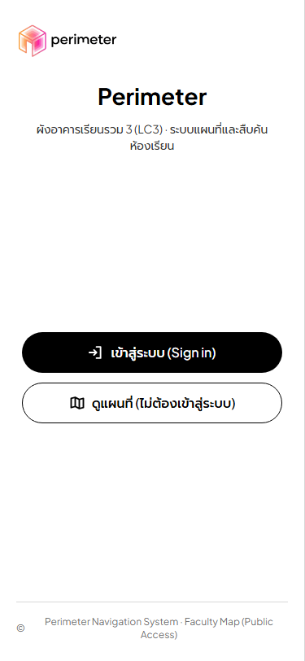
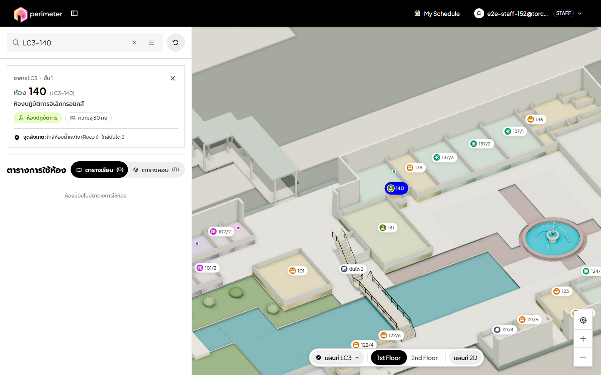
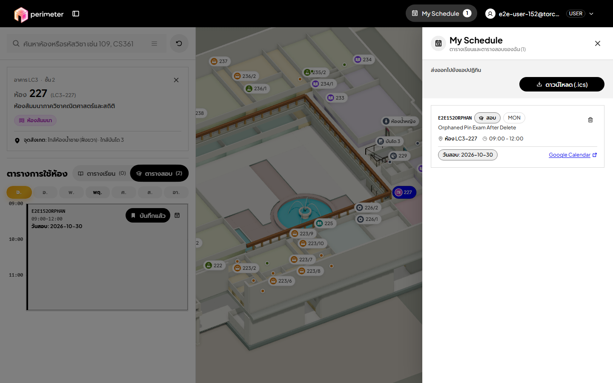
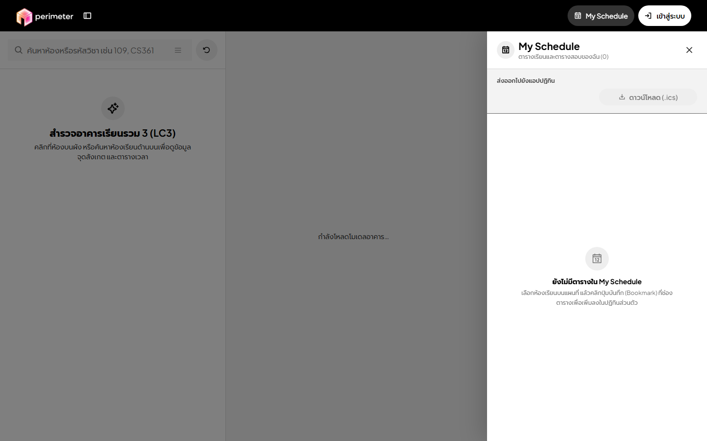
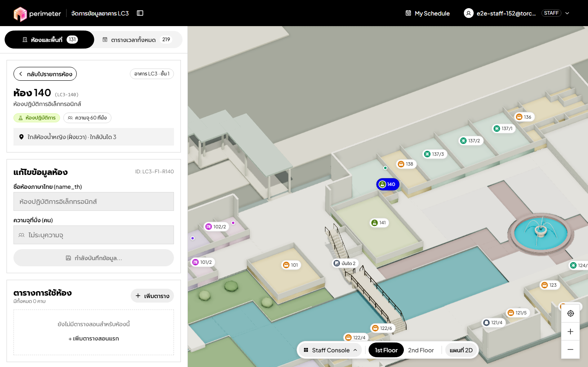
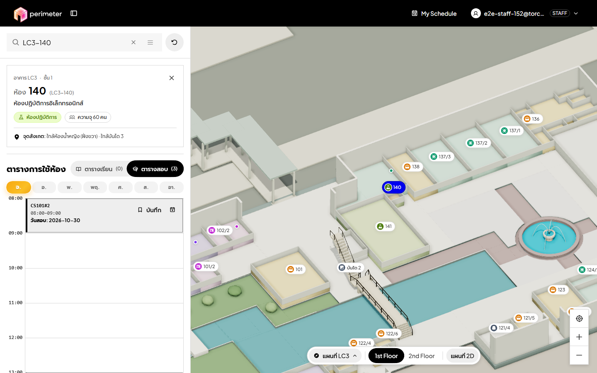
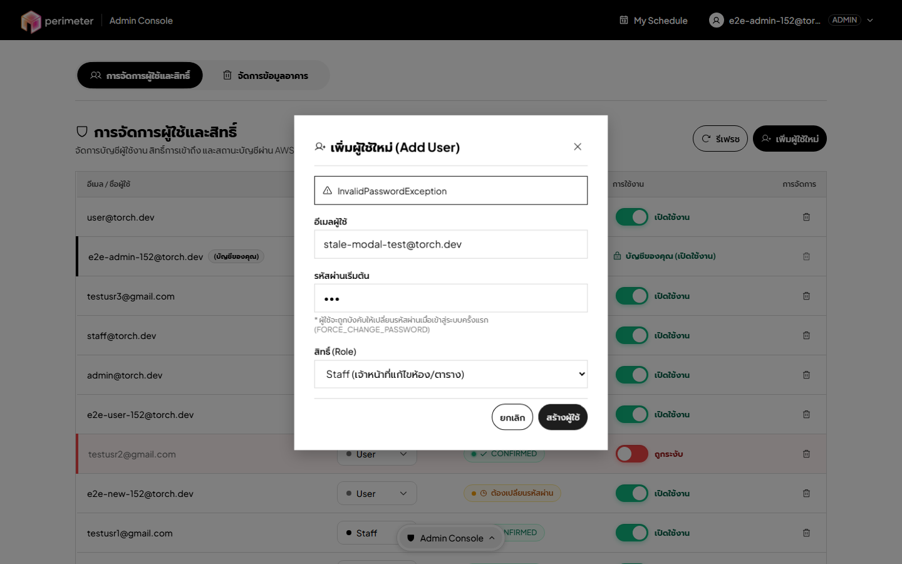
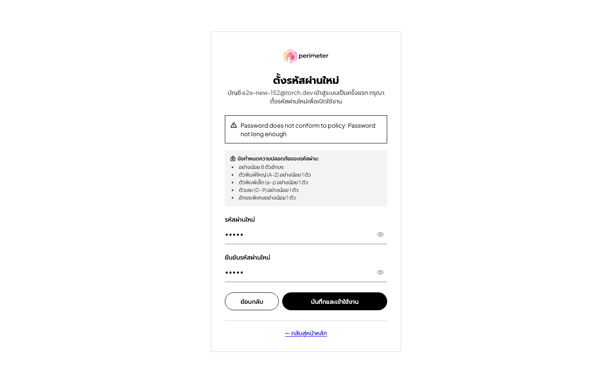
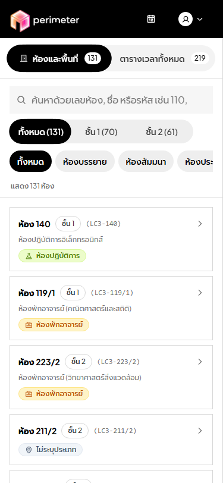
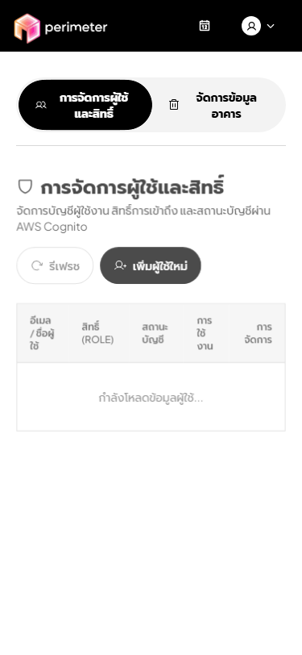

# E2E Exploratory Test Session Log & Bug Report Summary — #152

เอกสารนี้บันทึกผลการดำเนินงานทดสอบเชิงสำรวจแบบ End-to-End (E2E Exploratory Testing) ตามชุด Charter ที่กำหนดไว้ใน [`docs/testing/e2e-charters.md`](./e2e-charters.md) บนสภาพแวดล้อม AWS Academy Learner Lab (`us-east-1`, stack `torch-v2`) พร้อมหลักฐานภาพหน้าจอ ขั้นตอนการทำซ้ำ (Steps to Reproduce) การตรวจสอบความซ้ำซ้อนกับ Issue เดิม และสรุป 5 อันดับแรกที่ต้องแก้ไขก่อนการทดสอบกับผู้ใช้จริง (29–30 ต.ค. 2026)

---

## 1. ข้อมูลสภาพแวดล้อมและผู้ทดสอบ (Session Metadata)

| รายการ | รายละเอียด |
|---|---|
| **วันที่ทดสอบ** | 26 ต.ค. 2026 |
| **ผู้ทดสอบ (Tester)** | ทีมพัฒนา / QA Exploratory Session (#152) |
| **Target Backend Stack** | AWS Academy Learner Lab (`us-east-1`, Stack `torch-v2`, API `https://48bqx79pq6.execute-api.us-east-1.amazonaws.com/Prod`, Cognito User Pool `us-east-1_W6A9E3hLl`) |
| **อุปกรณ์และขนาดหน้าจอ** | Desktop (`1440×900`) และ Mobile (`375×812`) |
| **เบราว์เซอร์ที่ใช้ทดสอบ** | Chromium `156.0.8078.4` (Playwright E2E Runner) + ตรวจสอบ Cross-Engine Layout & DOM/A11y |
| **การจัดการข้อมูลทดสอบ** | สร้างบัญชีทดสอบแยกเฉพาะ (`e2e-*-152@torch.dev`) และรายการตารางชั่วคราว พร้อมลบและคืนค่าฐานข้อมูล DynamoDB / Cognito กลับสู่สถานะเดิม 100% หลังจบเซสชัน |

---

## 2. การตรวจสอบความซ้ำซ้อนกับ Issue ที่เปิดอยู่หรือแก้ไขแล้ว (Deduplication Check)

ก่อนสรุปรายการบั๊กใหม่ ได้ตรวจสอบเทียบกับ Issue ที่มีอยู่ตามที่ระบุใน #152 แล้ว ไม่มีการสร้างซ้ำ:
- **#90 (`fix: spa fallback returns 404 status on direct /map load` — OPEN):** ปัญหา S3 Static Website คืน HTTP 404 เมื่อโหลด `/map` โดยตรง — *ไม่นับซ้ำในรายการบั๊กใหม่*
- **#139 (`fix: My Schedule drawer renders under the mobile search bar, room sheet and desktop dock` — CLOSED):** ปัญหา z-index ของ `MyScheduleDrawer` ทับกับแถบค้นหาและ Bottom Dock — *แก้ไขแล้วใน `main` และตรวจยืนยันซ้ำแล้วว่าไม่เกิดซ้ำ*
- **#153 (`fix: staff cannot move an event to another room (104 -> 105)` — CLOSED):** ปัญหาการย้ายห้องของกิจกรรมใน `/staff` — *โค้ดบน `main` เพิ่ม `RoomCombobox` และ Transaction ย้ายห้องแล้ว แต่ในการสำรวจครั้งนี้พบผลกระทบต่อเนื่อง (Side-Effect) เรื่อง **Orphaned Pins** และ **Stale Cache 60 วินาที** ซึ่งแยกเป็นประเด็นใหม่*

---

## 3. บันทึกการทดสอบราย Charter (Session Log by Charter)

### Charter C-01: การค้นหาห้อง วิชา ตารางสอบ และกิจกรรม (`guest`, `user`)
- **ผู้ทดสอบ:** QA Session #152
- **เวลาที่ใช้จริง:** **18 นาที** (Time-box ≤ 45 นาที, `19:45–20:03 UTC+7`)
- **สิ่งที่ดำเนินการ:**
  - ทดสอบค้นหาบน `/` (Landing) และ `/map` ด้วยรหัสห้องตัวพิมพ์เล็ก/ใหญ่ (`lc3-103` vs `LC3-103`), ช่องว่างหน้า-หลัง (`"  lc3-103  "`), ชื่อภาษาไทย, รหัสวิชาสอบ (`BAS350`)
  - ทดสอบเลือกห้องจากผลการค้นหาบน `/map` แล้วสังเกต URL Query Parameter (`?room=`, `?q=`) และการกดปุ่ม Back/Forward ของเบราว์เซอร์
  - ทดสอบหน้า Landing (`/`) เปรียบเทียบระหว่าง Desktop (`1440×900`) กับ Mobile (`375×812`)
- **สิ่งที่พบ (Findings):**
  1. **[BUG-07]** บนหน้า `/map` เมื่อผู้ใช้ค้นหาหรือคลิกเลือกห้อง (เช่น `LC3-103`) URL บนแถบที่อยู่ยังคงเป็น `/map` เฉย ๆ ไม่มีการอัปเดต `?room=LC3-F1-R103` หรือ `?q=...` (โค้ดอ่าน `searchParams.get('room')` แค่ตอน mount ครั้งแรกใน `MapPage.tsx`) ทำให้กดปุ่ม Back ของเบราว์เซอร์เพื่อย้อนกลับไปห้องก่อนหน้าไม่ได้ และคัดลอก URL จากแถบเบราว์เซอร์ส่งต่อให้เพื่อนเปิดห้องเดียวกันไม่ได้
  2. **[BUG-10]** บนหน้า Landing (`/`) มีความไม่สอดคล้องกันระหว่าง Desktop กับ Mobile:
     - บน **Desktop (`1440×900`)** ปุ่ม `"ดูแผนที่ (ไม่ต้องเข้าสู่ระบบ)"` ถูกซ่อนไว้ด้วย `sm:hidden` (`LandingPage.tsx:270`) และใน Footer ก็ไม่มีลิงก์เข้าสู่ `/map` ทำให้ผู้ใช้ Desktop ที่ต้องการเข้าดูแผนที่เต็มจอโดยไม่ล็อกอินไม่มีปุ่ม CTA ที่มองเห็นได้ชัดเจน (ต้องเดาว่าต้องคลิกที่รูปโลโก้มุมซ้ายบน หรือต้องพิมพ์ค้นหาแล้วเลือกห้องก่อนจึงจะเจอปุ่ม `"เปิดดูตารางในโหมดแผนที่เต็ม"`)
     - บน **Mobile (`375×812`)** ช่องค้นหาด่วน (Instant Search Bar) ถูกซ่อนด้วย `hidden sm:block` (`LandingPage.tsx:199`) เหลือเพียงปุ่ม `"เข้าสู่ระบบ"` และ `"ดูแผนที่ (ไม่ต้องเข้าสู่ระบบ)"`
- **หลักฐาน (Evidence):**
  - 

---

### Charter C-02: แผนที่ 2D/3D และการเปิดดูรายละเอียดห้อง/ตารางรายสัปดาห์ (`guest`, `user`)
- **ผู้ทดสอบ:** QA Session #152
- **เวลาที่ใช้จริง:** **20 นาที** (Time-box ≤ 45 นาที, `20:03–20:23 UTC+7`)
- **สิ่งที่ดำเนินการ:**
  - เปิด `/map?room=LC3-F1-R103` และ `/map?room=LC3-F1-R140` สลับมุมมอง 3D ↔ 2D สลับชั้น 1 ↔ ชั้น 2 เปิดดูแท็บ `"ตารางเรียน"` และ `"ตารางสอบ"` รวมถึงเปิด `RoomDetailModal` (`ดูตารางทั้งหมด`)
- **สิ่งที่พบ (Findings):**
  1. **[BUG-01] (Critical — เชื่อมโยงกับ C-04):** แท็บ `"ตารางเรียน"` บนหน้า `/map` (`MapPage.tsx:344`) กรองเฉพาะรายการที่มี `s.eventType.toLowerCase() === 'class' || !s.eventType` เท่านั้น ส่วนแท็บ `"ตารางสอบ"` กรองเฉพาะ `eventType === 'exam'` ส่งผลให้ตารางใด ๆ ที่ Staff สร้างหรือแก้ไขผ่านหน้า `/staff` (ซึ่งดรอปดาวน์มีค่าเป็น `'lecture'`, `'lab'`, `'exam'`, `'other'`) เมื่อเลือกเป็น **บรรยาย (`lecture`), ปฏิบัติการ (`lab`), หรือกิจกรรมอื่นๆ (`other`) จะไม่แสดงผลบนหน้า `/map` เลยแม้แต่รายการเดียว!**
- **หลักฐาน (Evidence):**
  - 

---

### Charter C-03: การปักหมุด (Pin), My Schedule Drawer และการส่งออกปฏิทิน (`guest`, `user`, `staff`)
- **ผู้ทดสอบ:** QA Session #152
- **เวลาที่ใช้จริง:** **25 นาที** (Time-box ≤ 45 นาที, `20:05–20:30 UTC+7`)
- **สิ่งที่ดำเนินการ:**
  - ล็อกอินด้วยบัญชี `user` ปักหมุดตารางสอบ (`E2E152ORPHAN` ในห้อง `LC3-227`) เปิด `MyScheduleDrawer` ตรวจสอบปุ่มดาวน์โหลด `.ics` และลิงก์ Google Calendar
  - จำลองสถานการณ์ที่ Staff/Admin ลบตารางสอน/สอบ หรือย้ายห้อง/เปลี่ยนเวลา (`SmartFacultySchedules` ถูกลบหรือเปลี่ยนคีย์) แล้วเปิด `MyScheduleDrawer` ของผู้ใช้ที่ปักหมุดไว้
  - เปิด `MyScheduleDrawer` ค้างไว้ แล้วกดเมนูบัญชีมุมขวาบน → `"ออกจากระบบ (Sign out)"` จากนั้นกลับเข้าหน้า `/map` ในฐานะ `guest`
- **สิ่งที่พบ (Findings):**
  1. **[BUG-04] (High — Orphaned / Stale Pins):** เมื่อตารางใน `SmartFacultySchedules` ถูกลบ (ผ่าน `delete-schedule` หรือ `delete-location`) หรือถูก Staff ย้ายห้อง/เปลี่ยนเวลาเริ่ม/เปลี่ยนรหัสวิชา (`update-schedule` ลบคีย์เก่าและสร้างคีย์ใหม่) ข้อมูลในตาราง `SmartFacultyPins` ของผู้ใช้ที่เคยกดบันทึกไว้ **ไม่ถูกอัปเดตหรือลบตาม** ทำให้ใน `MyScheduleDrawer` ของผู้ใช้ยังคงแสดงรายการที่ถูกลบไปแล้ว หรือชี้ไปที่ห้องเดิม/เวลาเดิม (ขัดแย้งกับโจทย์ TC2 ที่ผู้ใช้ต้องเห็นห้องใหม่หลังการย้าย)
  2. **[BUG-08] (Medium — Drawer State Leak on Sign Out):** เมื่อผู้ใช้เปิด `MyScheduleDrawer` ค้างไว้ แล้วคลิก `"ออกจากระบบ (Sign out)"` จาก `AccountMenu` บนแถบด้านบน (`z-100` อยู่เหนือ Drawer ที่เป็น `z-95`) `PinsProvider` ล้างรายการ `pins` เป็น `[]` แต่ **ไม่ได้รีเซ็ต `isDrawerOpen` เป็น `false`** (`PinsProvider.tsx:52–58`) เมื่อผู้ใช้กลับเข้าหน้า `/map` ในฐานะ `guest` หน้าต่าง `MyScheduleDrawer` จะเด้งเปิดค้างขึ้นมาเองทั้งที่ยังไม่ได้ล็อกอิน
- **หลักฐาน (Evidence):**
  - 
  - 

---

### Charter C-04: Staff Pane — ความครบถ้วนของ CRUD ห้องและตารางกิจกรรม (`staff`, `admin`)
- **ผู้ทดสอบ:** QA Session #152
- **เวลาที่ใช้จริง:** **28 นาที** (Time-box ≤ 45 นาที, `19:48–20:16 UTC+7`)
- **สิ่งที่ดำเนินการ:**
  - ล็อกอินเป็น `staff` เข้าหน้า `/staff` ทดสอบแก้ไขข้อมูลห้อง `LC3-140` (ตั้งความจุเป็น `60` บันทึก แล้วลบช่องความจุให้ว่าง `""` เพื่อล้างค่าความจุ แล้วกดบันทึก)
  - ทดสอบสร้างตารางสอนใหม่ด้วยค่าเริ่มต้น `บรรยาย (Lecture)` (`event_type = 'lecture'`) แล้วไปตรวจที่ `/map`
  - ทดสอบหาปุ่มลบตารางสอนที่เพิ่งสร้างผิดในฐานะ `staff`
  - ตรวจสอบความล่าช้าของการอัปเดตข้อมูลเมื่อสลับหน้า `/staff` ↔ `/map`
- **สิ่งที่พบ (Findings):**
  1. **[BUG-01] (Critical — Event Type Mismatch `lecture`/`lab`/`other` vs `class`):** ใน `AdminPage.tsx` (`CreateScheduleForm` บรรทัด 596, 720–723 และ `ScheduleRow` บรรทัด 482–485) ตัวเลือกประเภทตารางส่งค่า `event_type` เป็น `'lecture' | 'lab' | 'exam' | 'other'` (โดยค่าเริ่มต้นคือ `'lecture'`) แต่ใน `MapPage.tsx` (บรรทัด 344–351) กรองเฉพาะ `'class'` และ `'exam'` เท่านั้น ทำให้ตารางประเภท `'lecture'`, `'lab'`, และ `'other'` ทั้งหมดที่สร้างหรือแก้ไขผ่าน `/staff` หายไปจากหน้า `/map`! (หมายเหตุ: กิจกรรมใน TC2 ของการทดสอบผู้ใช้จริงกำหนด `event_type: 'other'` ใน `test-fixtures.md` ซึ่งจะไม่แสดงในแท็บตารางการใช้ห้องของ `RoomDetailContent` บน `/map` ด้วย!)
  2. **[BUG-02] (High — 60s Stale In-Memory Cache on Lambda Read Endpoints):** Lambda `get-locations` และ `get-schedules` เก็บ In-Memory Cache นาน 60 วินาที (`CACHE_TTL_MS = 60_000`) โดยไม่สนใจ Header `Cache-Control: no-cache` จากเบราว์เซอร์ เมื่อ Staff หรือ Admin สร้าง/แก้ไข/ย้าย/ลบตาราง หรือแก้ชื่อ/ความจุห้อง แล้วหน้าเว็บเรียก `reloadRooms(true)` / `reloadSchedules(true)` ทันที API จะคืนข้อมูลเก่าจาก Memory ของ Lambda นานสูงสุด 60 วินาที ทำให้ดูเหมือนการบันทึกไม่ทำงาน
  3. **[BUG-05] (Medium — Clearing Room Capacity Silently Ignored):** ใน `AdminPage.tsx` (บรรทัด 822–825) เมื่อ Staff ลบตัวเลขในช่อง `"ความจุที่นั่ง (คน)"` ออกจนว่าง (`""`) เพื่อล้างค่าความจุ โค้ดแปลงค่าว่างเป็น `undefined` และไม่ส่งฟิลด์ `capacity` ไปใน `PUT /api/locations/{id}` หน้าจอแสดงข้อความสีเขียว `"บันทึกข้อมูลห้องสำเร็จเรียบร้อย"` แต่ใน DynamoDB (`SmartFacultyLocations`) และป้ายกำกับบนหน้าจอยังคงเป็น `ความจุ 60 ที่นั่ง` เหมือนเดิม
  4. **[BUG-09] (Medium — Staff Cannot Delete Mistakenly Created Schedule):** Role `staff` มีสิทธิ์สร้าง (`POST /api/schedules`) และแก้ไข (`PUT /api/schedules/...`) ตารางได้ แต่ไม่มีสิทธิ์ลบ (`DELETE /api/schedules/...` จำกัดเฉพาะ `admin` ใน `delete-schedule/index.mjs:38` และซ่อนปุ่มถังขยะใน `AdminPage.tsx:563`) หาก Staff สร้างตารางผิดพลาดหรือสร้างซ้ำ จะไม่สามารถลบรายการที่ตัวเองเพิ่งสร้างออกได้เลย
- **หลักฐาน (Evidence):**
  - 

---

### Charter C-05: Staff Pane — ขอบเขตข้อมูล (EP/BVA) และการเดาข้อผิดพลาดในฟอร์มตาราง/ห้อง (`staff`)
- **ผู้ทดสอบ:** QA Session #152
- **เวลาที่ใช้จริง:** **32 นาที** (Time-box ≤ 45 นาที, `19:50–20:22 UTC+7`)
- **สิ่งที่ดำเนินการ:**
  - ทดสอบกรอกเวลาเริ่มมากกว่าเวลาสิ้นสุด (`start_time = "16:00"`, `end_time = "09:00"`), เวลาผิดรูปแบบ (`"25:99"`), และไม่กรอก `end_time`
  - ทดสอบสร้างตารางสอบ (`exam`) โดยเลือกวันเป็น `วันจันทร์ (MON)` แต่เลือกวันที่สอบ `event_date = "2026-10-28"` (ซึ่งเป็นวันพุธ) และ `"2026-10-30"` (วันศุกร์)
  - ทดสอบกรอกรหัสวิชาที่มีเครื่องหมาย `#` (เช่น `CS101#2`) และทดสอบกับห้องที่มีเครื่องหมาย `/` ในรหัสห้องจริง (`LC3-118/1`)
- **สิ่งที่พบ (Findings):**
  1. **[BUG-06] (Medium — Unvalidated Time Inputs & Exam Weekday/Date Contradiction):**
     - ช่อง `เวลาเริ่ม` และ `เวลาสิ้นสุด` ใน `/staff` (`AdminPage.tsx:447, 684`) เป็น `<input type="text">` ธรรมดาและ `end_time` ไม่ได้บังคับกรอก (`required`) ส่วน Backend (`create-schedule`, `update-schedule`) ตรวจเพียงว่ามี `start_time` หรือไม่ แต่ไม่ตรวจรูปแบบ `HH:MM` และไม่ตรวจว่า `start_time < end_time` ทำให้บันทึกเวลา `16:00–09:00` หรือ `25:99` ลง DynamoDB ได้สำเร็จ แล้วไปขึ้นกล่องเตือน `"คาบที่แสดงในตารางไม่ได้ (เวลาหรือวันไม่ถูกต้อง)"` (`timetable-skipped`) บนหน้า `/map`
     - เมื่อสร้างตารางสอบ (`exam`) ระบบอนุญาตให้เลือก `day_of_week = MON` คู่กับ `event_date = 2026-10-30` (วันศุกร์) หรือ `2026-10-28` (วันพุธ) โดยไม่ตรวจสอบหรือคำนวณ `day_of_week` จาก `event_date` อัตโนมัติ ทำให้บน `/map` รายการสอบถูกวางไว้ในคอลัมน์ **วันจันทร์ (`จ.`)** แต่มีป้ายกำกับเขียนว่า `วันสอบ: 2026-10-30` (วันศุกร์) สร้างความสับสนอย่างมาก
  2. **[BUG-12] (Medium — Delimiter `#` / `/` & Whitespace in Schedule Keys):**
     - คีย์ `schedule_slot` ใน DynamoDB ใช้รูปแบบ `${day_of_week}#${start_time}#${event_code}` และฝั่ง Frontend (`schedulesService.ts:8–19`) ทิ้งค่า `raw.schedule_slot` แล้วประกอบคีย์ใหม่เองจากฟิลด์ย่อย หากผู้ใช้เผลอกรอกช่องว่างล้วน (`"   "`) หรืออักขระพิเศษ/รหัสห้องที่มี `/` (`LC3-118/1`) หรือ `#` โดยไม่มีการ `.trim()` และตรวจสอบรูปแบบ จะทำให้คีย์ผิดเพี้ยนหรือเกิดปัญหากับ Path Parameter ของ API Gateway
- **หลักฐาน (Evidence):**
  - 

---

### Charter C-06: Admin Management — การจัดการผู้ใช้ สิทธิ์ และข้อมูลอาคาร (`admin`)
- **ผู้ทดสอบ:** QA Session #152
- **เวลาที่ใช้จริง:** **15 นาที** (Time-box ≤ 45 นาที, `20:08–20:23 UTC+7`)
- **สิ่งที่ดำเนินการ:**
  - ล็อกอินเป็น `admin` เข้าหน้า `/admin` เปิด Modal `"เพิ่มผู้ใช้ใหม่"` ทดสอบกดปุ่ม `Escape` บนคีย์บอร์ด
  - กรอกอีเมล `stale-modal-test@torch.dev` และรหัสผ่านสั้นเกินไป (`123`) กด `"สร้างผู้ใช้"` เพื่อให้เกิด Error จากนั้นกด `"ยกเลิก"` หรือปุ่ม `X` เพื่อปิด Modal แล้วกด `"เพิ่มผู้ใช้ใหม่"` เปิดขึ้นมาอีกครั้ง
  - ตรวจสอบการสลับสถานะเปิด/ระงับบัญชี (`toggle-enabled-btn`) ซ้ำเร็ว ๆ และตรวจหาฟีเจอร์รีเซ็ตรหัสผ่าน
- **สิ่งที่พบ (Findings):**
  1. **[BUG-11] (Low — Admin Modal Stale State, Missing `Escape` Close, & Raw Exception Name):**
     - เมื่อปิด Modal `"เพิ่มผู้ใช้ใหม่"` แล้วเปิดใหม่ ค่า `newEmail`, `newPassword`, `newRole` และกล่องแจ้งเตือน Error (`⚠ InvalidPasswordException`) จากครั้งก่อนยังคงค้างอยู่ ไม่ถูกล้างค่า (`AdminManagementPage.tsx:834–926`)
     - ข้อความแจ้งเตือนเมื่อตั้งรหัสผ่านเริ่มต้นไม่ผ่านเกณฑ์แสดงเป็นชื่อ Exception ดิบของ AWS (`InvalidPasswordException`) แทนที่จะเป็นข้อความภาษาไทยที่เข้าใจง่าย
     - การกดปุ่ม `Escape` บนคีย์บอร์ดไม่สามารถปิด Modal `"เพิ่มผู้ใช้ใหม่"` หรือ Modal `"ยืนยันการลบผู้ใช้"` ได้ และทั้งสอง Modal ไม่มี `role="dialog"` / `aria-modal="true"`
     - Кроме того, Admin ไม่มีฟีเจอร์รีเซ็ตรหัสผ่านให้ผู้ใช้ที่ลืมรหัสผ่านหรือติดสถานะ `FORCE_CHANGE_PASSWORD` (ทำได้เพียงลบผู้ใช้แล้วสร้างใหม่)
- **หลักฐาน (Evidence):**
  - 

---

### Charter C-07: การยืนยันตัวตน, First-Login Challenge และการป้องกัน Route (`guest`, `user`, `staff`, `admin`)
- **ผู้ทดสอบ:** QA Session #152
- **เวลาที่ใช้จริง:** **16 นาที** (Time-box ≤ 45 นาที, `20:10–20:26 UTC+7`)
- **สิ่งที่ดำเนินการ:**
  - ล็อกอินด้วยบัญชีใหม่ `e2e-new-152@torch.dev` ที่อยู่ในสถานะ `FORCE_CHANGE_PASSWORD` (`NEW_PASSWORD_REQUIRED`) แล้วกรอกรหัสผ่านใหม่ที่สั้นเกินไป (`short`)
  - ทดสอบ `RouteGuard` เมื่อเข้า `/staff` และ `/admin` ด้วย Role ที่ไม่มีสิทธิ์
  - ทดสอบกรณีที่เปิดหน้า `/staff` หรือ `/admin` ค้างไว้จนกระทั่ง JWT Token หมดอายุ (`session.expiresAt`)
- **สิ่งที่พบ (Findings):**
  1. **[BUG-10 / Auth Error UX]:** ในหน้า `/login` และหน้าตั้งรหัสผ่านครั้งแรก (`LoginPage.tsx:70, 93`) เมื่อ Cognito ปฏิเสธการเข้าสู่ระบบหรือรหัสผ่านใหม่ไม่ผ่านเกณฑ์ หน้าจอแสดงข้อความภาษาอังกฤษดิบจาก AWS SDK โดยตรง เช่น `"Password does not conform to policy: Password not long enough"` หรือ `"Incorrect username or password."` ปะปนใน UI ภาษาไทย
  2. **ข้อสังเกตเรื่อง Session Expiry ระหว่างเปิดหน้า `/staff` หรือ `/admin` ค้างไว้:** เมื่อ Token หมดอายุขณะผู้ใช้เปิดหน้า `/staff` ค้างไว้โดยไม่ได้เปลี่ยน Route `TopBar.tsx` มี Timer ที่เปลี่ยนปุ่มมุมขวาบนเป็น `"เข้าสู่ระบบ"` ทันที แต่ `RouteGuard.tsx` ตรวจเฉพาะตอนเปลี่ยน Route/Render ทำให้ฟอร์ม `/staff` ยังค้างอยู่บนหน้าจอจนกว่าจะกด Refresh หรือกดบันทึกแล้วเจอ Error 401
- **หลักฐาน (Evidence):**
  - 

---

### Charter C-08: การแสดงผลบนมือถือ (Responsive 375px) และ Accessibility พื้นฐานทุกหน้า (`guest`, `user`, `staff`, `admin`)
- **ผู้ทดสอบ:** QA Session #152
- **เวลาที่ใช้จริง:** **20 นาที** (Time-box ≤ 45 นาที, `20:06–20:26 UTC+7`)
- **สิ่งที่ดำเนินการ:**
  - เปิดหน้า `/staff` และ `/admin` บนหน้าจอมือถือขนาด `375×812` ด้วยบัญชี `staff` และ `admin`
  - พยายามย่อแผงรายการห้องด้านซ้าย (`aside`) บนหน้า `/staff` เพื่อดูแผนที่ และพยายามสลับหน้างานระหว่าง `/map` ↔ `/staff` ↔ `/admin` บนมือถือ
  - ตรวจสอบ Accessibility Tree (`<label htmlFor>`, `aria-label` ของปุ่มไอคอน, การโฟกัสคีย์บอร์ด)
- **สิ่งที่พบ (Findings):**
  1. **[BUG-03] (High — Mobile 375px Lockout on `/staff` & `/admin`):**
     - บนหน้าจอมือถือ `375×812` (`< 640px`) แผงด้านซ้าย (`<aside>`) ของหน้า `/staff` มีความกว้างเต็มหน้าจอ (`w-full` = `375px`, `AdminPage.tsx:1504`) บังแผนที่ด้านหลังทั้งหมด 100% **แต่ปุ่มย่อ/ซ่อนแผงด้านซ้าย (`SidebarSimple`) บน `TopBar` ถูกใส่คลาส `hidden sm:inline-flex` (`TopBar.tsx:213`)!** ทำให้ Staff ที่ใช้งานผ่านมือถือ **ไม่สามารถพับเก็บแผงด้านซ้ายเพื่อดูแผนที่ได้แม่แต่น้อย!**
     - ยิ่งไปกว่านั้น แถบควบคุมด้านล่าง (`Bottom Dock` ซึ่งมีปุ่มสลับพื้นที่ทำงาน `Workspace Switcher`, ปุ่มสลับชั้น `1st Floor / 2nd Floor`, และปุ่มสลับ `2D / 3D`) ถูกใส่คลาส `hidden sm:flex` (`TopBar.tsx:246`) ทำให้บนมือถือ `375px` ทั้ง `staff` และ `admin` **ไม่มีปุ่มสลับไปมาระหว่างหน้า `/map`, `/staff`, และ `/admin` เลย** (ต้องพิมพ์แก้ URL บนเบราว์เซอร์เองเท่านั้น)
  2. **[BUG-11 / A11y Gaps in `/staff` & `/admin`]:**
     - ในฟอร์มสร้างและแก้ไขตารางสอน (`AdminPage.tsx` `CreateScheduleForm` และ `ScheduleRow`) ป้าย `<label>` ทั้ง 6 ช่อง (`วัน *`, `รหัสวิชา *`, `เวลาเริ่ม *`, `เวลาสิ้นสุด`, `ชื่อวิชา`, `ประเภท`) **ไม่มีการผูก `htmlFor` กับ `id` ของ `<input>`/`<select>` เลย** ทำให้ Screen Reader ไม่สามารถอ่านชื่อช่องกรอกข้อมูลได้ และผู้ใช้คลิกที่ข้อความ Label เพื่อโฟกัสช่องกรอกไม่ได้
     - ปุ่มปิดฟอร์ม (`<X size={14} />`) ใน `CreateScheduleForm` (`AdminPage.tsx:639`), `ScheduleRow` (`AdminPage.tsx:413`), และปุ่มปิดใน `AdminManagementPage.tsx` (บรรทัด 469, 843) เป็นปุ่มไอคอนล้วนที่ **ไม่มี `aria-label` หรือ `title`**
- **หลักฐาน (Evidence):**
  - 
  - 

---

### Charters ที่รอดำเนินการ (Deferred Charters)
- **Charter C-09 (Navigation UI — รอ #145):** ข้ามการทดสอบ UI นำทางในรอบนี้เนื่องจาก #145 ยังเปิดอยู่และยังไม่มี UI เลือกจุดเริ่มต้น/ปลายทางใน `frontend/` ณ วันที่ 26 ต.ค. 2026
- **Charter C-10 (Closure Status & Staff Toggle — รอ #147):** ข้ามการทดสอบ UI ปิดทางเดิน/ห้องในรอบนี้เนื่องจาก #147 ยังเปิดอยู่ ณ วันที่ 26 ต.ค. 2026

---

## 4. รายการ Bug / UX Flaw ทั้งหมดที่พบ และ GitHub Issues ที่สร้าง

> **หมายเหตุการจัดกลุ่ม (Tier 1 vs Tier 2):**
> - **Tier 1 (ต้องแก้คืนนี้ก่อนการทดสอบผู้ใช้จริงวันพุธที่ 28 ต.ค.):** รวม 6 บั๊กสำคัญ (`BUG-01`, `BUG-02`, `BUG-03`, `BUG-06`, `BUG-08`, `BUG-09`) ไว้ใน **Issue #176** (เปิดใช้งานและมอบหมายงานแล้ว) พร้อมรายละเอียดเชิงลึกสำหรับนำไป Implement และทดสอบต่อทันที
> - **Tier 2 (Draft Backlog หลังจบการทดสอบผู้ใช้จริง):** แยกเป็น **Issues #177 – #182** (`BUG-04`, `BUG-05`, `BUG-07`, `BUG-10`, `BUG-11`, `BUG-12`) โดยติดป้าย `[DRAFT — Post-User-Test]` + Label `bug` และพักสถานะไว้ชั่วคราว (Deferred) เพื่อไม่ให้รบกวนคิวงานหลักของทีมก่อนวันทดสอบจริง (สามารถกด Reopen ได้ทันทีหลังวันที่ 28–30 ต.ค.)

### BUG-01: ตารางประเภท `lecture`, `lab`, และ `other` ที่สร้างหรือแก้ไขใน `/staff` ไม่แสดงผลบนหน้า `/map`
- **GitHub Issue:** **#176** (`fix: resolve critical pre-user-test E2E bugs across map, staff console, mobile nav, and schedule cache`)
- **Branch Name:** `fix/pre-user-test-blockers`
- **Labels:** `bug`, `priority: 0 critical`, `full-stack`, `wave-1`
- **Environment:** Desktop (`1440×900`) & Mobile (`375×812`), Chromium / Firefox
- **Steps to Reproduce:**
  1. ล็อกอินด้วยบัญชี `staff` หรือ `admin` แล้วไปที่หน้า `/staff`
  2. เลือกห้องเรียน (เช่น `LC3-140` หรือ `LC3-225`) แล้วคลิก `"+ เพิ่มตาราง"`
  3. กรอกรหัสวิชา เวลาเริ่ม-สิ้นสุด ชื่อวิชา โดยเลือกประเภทเป็นค่าเริ่มต้น `"บรรยาย (Lecture)"` (`lecture`), `"ปฏิบัติการ (Lab)"` (`lab`), หรือ `"อื่นๆ (Other)"` (`other`) แล้วกด `"+ บันทึกตารางสอน"`
  4. เปิดหน้า `/map` แล้วค้นหาและคลิกห้องดังกล่าวเพื่อดู `"ตารางการใช้ห้อง"`
- **Expected Result:** ตารางเรียนบรรยาย (`lecture`), ปฏิบัติการ (`lab`), และกิจกรรม (`other`) ต้องแสดงในตารางการใช้ห้องบนหน้า `/map`
- **Actual Result:** แท็บ `"ตารางเรียน (0)"` ว่างเปล่า (`"ห้องนี้ยังไม่มีตารางการใช้ห้อง"`) เพราะ `MapPage.tsx` (บรรทัด 344–351) กรองเฉพาะ `s.eventType.toLowerCase() === 'class' || !s.eventType` ในขณะที่ฟอร์มบน `/staff` (`AdminPage.tsx` บรรทัด 596, 720–723) บันทึกค่าเป็น `'lecture' | 'lab' | 'exam' | 'other'`

---

### BUG-02: การแก้ไขข้อมูลห้องหรือตารางใน `/staff` และ `/admin` แสดงข้อมูลเก่าค้างนานถึง 60 วินาทีเนื่องจาก In-Memory Cache บน Lambda
- **GitHub Issue:** **#176** (Tier 1 Pre-User-Test Bundle)
- **Branch Name:** `fix/pre-user-test-blockers`
- **Labels:** `bug`, `priority: 1 high`
- **Environment:** Desktop & Mobile, Chromium / Firefox, AWS API Gateway + Lambda (`torch-v2`)
- **Steps to Reproduce:**
  1. เปิดหน้า `/map` หรือ `/staff` เพื่อให้ `GET /api/locations` และ `GET /api/schedules` ถูกแคชในหน่วยความจำของ Lambda
  2. ในหน้า `/staff` ทำการสร้างตารางใหม่ ย้ายห้อง (#153) หรือแก้ไขชื่อ/ความจุห้อง แล้วกดบันทึก
  3. สังเกตข้อมูลในรายการบนหน้า `/staff` หรือสลับไปเปิดห้องนั้นบน `/map` ทันทีภายใน 60 วินาที
- **Expected Result:** หลังการสร้าง/แก้ไข/ย้าย/ลบสำเร็จ การเรียก `reloadRooms(true)` / `reloadSchedules(true)` หรือการเปิดดูห้องบน `/map` ต้องเห็นข้อมูลล่าสุดทันที
- **Actual Result:** แม้ Frontend จะส่ง `{ cache: 'no-cache' }` แต่ `functions/get-locations/index.mjs` และ `functions/get-schedules/index.mjs` ใช้ตัวแปร Global In-Memory Cache (`CACHE_TTL_MS = 60_000`) โดยไม่ตรวจสอบ Query/Header สำหรับ Bypass Cache ทำให้ API คืนข้อมูลเก่าก่อนแก้ไขนานสูงสุด 60 วินาที

---

### BUG-03: หน้า `/staff` และ `/admin` บนมือถือ (`375px`) ซ่อนปุ่มพับ Sidebar และปุ่มสลับพื้นที่ทำงาน ทำให้ดูแผนที่และเปลี่ยนหน้าไม่ได้
- **GitHub Issue:** **#176** (Tier 1 Pre-User-Test Bundle)
- **Branch Name:** `fix/pre-user-test-blockers`
- **Labels:** `bug`, `priority: 1 high`
- **Environment:** Mobile (`375×812`), Chromium / Firefox
- **Steps to Reproduce:**
  1. เปิดเบราว์เซอร์ที่ขนาดหน้าจอมือถือ `375×812` แล้วล็อกอินด้วยบัญชี `staff` หรือ `admin`
  2. เมื่อเข้าสู่หน้า `/staff` พยายามพับเก็บแผงรายการห้องด้านซ้ายเพื่อดูแผนที่อาคาร หรือพยายามสลับไปหน้า `/map` หรือ `/admin`
- **Expected Result:** บนมือถือ `375px` Staff ต้องสามารถสลับดูแผนที่กับแผงแก้ไขข้อมูลได้ และมีเมนูสำหรับสลับระหว่าง `/map`, `/staff`, และ `/admin`
- **Actual Result:** แผง `<aside>` บน `/staff` กว้างเต็มจอ (`w-full` = `375px`) บังแผนที่ 100% ในขณะที่ปุ่มย่อแผงด้านซ้ายบน `TopBar` (`hidden sm:inline-flex`) และ Bottom Dock ที่มี `Workspace Switcher` (`hidden sm:flex`) ถูกซ่อนบนหน้าจอ `< 640px` ทำให้ดูแผนที่ไม่ได้และเปลี่ยนหน้าไม่ได้เลย

---

### BUG-04: การลบหรือย้ายตารางสอน/สอบทิ้งรายการปักหมุดกำพร้า (Orphaned/Stale Pins) ค้างใน `MyScheduleDrawer`
- **GitHub Issue:** **#177** (`fix: deleting or moving a schedule leaves orphaned or stale pins in MyScheduleDrawer`)
- **Branch Name:** `fix/orphaned-pins-on-schedule-change`
- **Labels:** `bug`, `priority: 2 medium`
- **Environment:** Desktop & Mobile, Chromium / Firefox
- **Steps to Reproduce:**
  1. ล็อกอินเป็น `user` แล้วกดปุ่ม `"บันทึก"` (Pin) รายการเรียนหรือสอบในห้องหนึ่ง (เช่น `LC3-225`)
  2. ให้ `staff` ย้ายรายการนั้นไปห้องอื่น (เช่น `LC3-227` ตามโจทย์ TC2) หรือเปลี่ยนเวลา หรือให้ `admin` ลบรายการตารางนั้นออก
  3. กลับมาที่หน้าจอของ `user` แล้วเปิด `My Schedule`
- **Expected Result:** รายการใน `My Schedule` ต้องไม่อ้างอิงไปยังตารางที่ถูกลบไปแล้ว หรือต้องได้รับการตรวจสอบ/ซิงก์กับตารางจริงเพื่อไม่ให้แสดงห้องเก่าที่ย้ายไปแล้ว
- **Actual Result:** `MyScheduleDrawer` อ่านข้อมูล Snapshot จาก `SmartFacultyPins` โดยตรงโดยไม่ตรวจสอบกับ `SmartFacultySchedules` ทำให้ตารางที่ถูกลบหรือย้ายห้องแล้วยังคงค้างเป็นข้อมูลเก่า/กำพร้าอยู่ใน `My Schedule`

---

### BUG-05: การล้างค่าความจุห้อง (`capacity`) ในหน้า `/staff` แจ้งว่าบันทึกสำเร็จแต่ค่าเดิมในฐานข้อมูลไม่ถูกลบ
- **GitHub Issue:** **#178** (`fix: clearing room capacity input in /staff silently keeps previous capacity value`)
- **Branch Name:** `fix/staff-clear-room-capacity`
- **Labels:** `bug`, `priority: 2 medium`
- **Environment:** Desktop & Mobile, Chromium
- **Steps to Reproduce:**
  1. ล็อกอินเป็น `staff` เข้าหน้า `/staff` แล้วเลือกห้องที่มีค่าความจุอยู่แล้ว (เช่น `60`)
  2. ลบตัวเลขในช่อง `"ความจุที่นั่ง (คน)"` ออกจนว่างเปล่า (`""`) แล้วกด `"บันทึกข้อมูลห้อง"`
- **Expected Result:** ระบบต้องล้างค่า `capacity` ของห้องนั้นออก (หรือส่ง `null` เพื่อ `REMOVE` ฟิลด์ `capacity` ใน DynamoDB)
- **Actual Result:** `AdminPage.tsx` (บรรทัด 822–825) แปลงค่าว่างเป็น `undefined` และตัดฟิลด์ `capacity` ออกจาก Payload ที่ส่งไป `PUT /api/locations/{id}` หน้าจอแสดงข้อความ `"บันทึกข้อมูลห้องสำเร็จเรียบร้อย"` แต่ค่าความจุเดิม (`60`) ยังคงอยู่ใน DynamoDB ไม่เปลี่ยนแปลง

---

### BUG-06: ฟอร์มสร้าง/แก้ไขตารางใน `/staff` ไม่ตรวจสอบรูปแบบเวลา (`start_time >= end_time`) และยอมให้วันสอบ (`event_date`) ขัดแย้งกับ `day_of_week`
- **GitHub Issue:** **#176** (Tier 1 Pre-User-Test Bundle)
- **Branch Name:** `fix/pre-user-test-blockers`
- **Labels:** `bug`, `priority: 2 medium`
- **Environment:** Desktop & Mobile, Chromium
- **Steps to Reproduce:**
  1. ในหน้า `/staff` เปิดฟอร์มเพิ่มตารางสอนใหม่ กรอก `เวลาเริ่ม = 16:00`, `เวลาสิ้นสุด = 09:00` (หรือ `25:99`) แล้วกดบันทึก
  2. สร้างตารางประเภท `"การสอบ (Exam)"` โดยเลือก `วัน = วันจันทร์ (MON)` แต่เลือก `วันที่จัด (YYYY-MM-DD) = 2026-10-30` (ซึ่งตรงกับวันศุกร์) แล้วกดบันทึก
  3. เปิดดูห้องนั้นในหน้า `/map` แท็บ `"ตารางสอบ"`
- **Expected Result:** ฟอร์มและ API ต้องปฏิเสธเวลาที่ไม่อยู่ในรูปแบบ `00:00–23:59` หรือกรณี `start_time >= end_time` และสำหรับตารางสอบที่มี `event_date` วันในสัปดาห์ (`day_of_week`) ต้องตรงกับวันที่จริงของ `event_date` เสมอ
- **Actual Result:** ระบบบันทึกทั้งสองรายการลง DynamoDB ได้สำเร็จ โดยรายการที่เวลาผิดไปโผล่ในกล่องแจ้งเตือน `timetable-skipped` บน `/map` ส่วนรายการสอบวันศุกร์ไปแสดงอยู่ในคอลัมน์ **วันจันทร์ (`จ.`)** พร้อมป้าย `วันสอบ: 2026-10-30`

---

### BUG-07: การค้นหาและคลิกเลือกห้องบน `/map` ไม่ซิงก์ URL Query Parameter (`?room=`, `?q=`) ทำให้กดปุ่ม Back หรือแชร์ลิงก์ไม่ได้
- **GitHub Issue:** **#179** (`fix: sync selected room and search query with URL parameters on /map`)
- **Branch Name:** `fix/map-url-query-sync`
- **Labels:** `bug`, `priority: 2 medium`
- **Environment:** Desktop & Mobile, Chromium / Firefox
- **Steps to Reproduce:**
  1. เข้าหน้า `/map` แล้วคลิกเลือกห้อง `LC3-103` จากแผนที่หรือช่องค้นหา
  2. สังเกต URL บนแถบเบราว์เซอร์ จากนั้นคลิกเลือกห้องอื่น (`LC3-140`) แล้วกดปุ่ม `Back` ของเบราว์เซอร์
- **Expected Result:** URL ควรอัปเดตเป็น `/map?room=LC3-F1-R103` เพื่อให้แชร์ลิงก์ห้องได้และกดปุ่ม Back เพื่อย้อนกลับไปห้องก่อนหน้าได้
- **Actual Result:** `MapPage.tsx` (บรรทัด 297–319) อ่าน `searchParams` เฉพาะตอน mount ครั้งแรกเท่านั้นแต่ไม่เคยเรียก `setSearchParams` เมื่อเลือกห้องหรือค้นหา ทำให้ URL ค้างอยู่ที่ `/map` และเมื่อกด Back จะหลุดออกจากหน้า `/map` ทันที

---

### BUG-08: การกดออกจากระบบ (Sign Out) ขณะเปิด `MyScheduleDrawer` ค้างไว้ ทำให้ Drawer เด้งเปิดค้างเมื่อกลับเข้า `/map` ในฐานะ `guest`
- **GitHub Issue:** **#176** (Tier 1 Pre-User-Test Bundle)
- **Branch Name:** `fix/pre-user-test-blockers`
- **Labels:** `bug`, `priority: 2 medium`
- **Environment:** Desktop & Mobile, Chromium
- **Steps to Reproduce:**
  1. ล็อกอินเข้าใช้งาน เปิดหน้า `/map` แล้วคลิกปุ่ม `My Schedule` บนแถบด้านบนเพื่อเปิด Drawer
  2. ขณะที่ Drawer เปิดอยู่ คลิกเมนูบัญชีมุมขวาบน แล้วคลิก `"ออกจากระบบ (Sign out)"`
  3. เมื่อกลับมาหน้าแรก (`/`) ให้คลิกเข้าสู่หน้า `/map` ในฐานะผู้ใช้ทั่วไป (`guest`)
- **Expected Result:** เมื่อออกจากระบบ สถานะ `isDrawerOpen` ต้องถูกปิดเป็น `false`
- **Actual Result:** `PinsProvider.tsx` (บรรทัด 52–58) ล้างเฉพาะอาร์เรย์ `pins` แต่ไม่ตั้งค่า `setIsDrawerOpen(false)` เมื่อเซสชันหายไป ทำให้เมื่อเข้าหน้า `/map` ผ่าน React Router หน้าต่าง `My Schedule` จะเปิดค้างอยู่ทั้งที่เป็น `guest`

---

### BUG-09: เจ้าหน้าที่ (`staff`) สร้างตารางสอน/สอบได้แต่ไม่มีสิทธิ์ลบตารางที่ตัวเองสร้างผิดพลาด
- **GitHub Issue:** **#176** (Tier 1 Pre-User-Test Bundle)
- **Branch Name:** `fix/pre-user-test-blockers`
- **Labels:** `bug`, `priority: 2 medium`
- **Environment:** Desktop & Mobile, Chromium (`staff` role)
- **Steps to Reproduce:**
  1. ล็อกอินด้วยบัญชี `staff` เข้าหน้า `/staff`
  2. เลือกห้องเรียนแล้วกด `"+ เพิ่มตาราง"` เพื่อสร้างตารางสอนใหม่
  3. เมื่อสร้างเสร็จ พยายามลบรายการตารางที่เพิ่งสร้างผิด
- **Expected Result:** `staff` ซึ่งมีหน้าที่ดูแลตารางสอน/สอบควรสามารถลบรายการตารางที่สร้างผิดพลาดได้ (สอดคล้องกับ `CONTEXT.md` และ `docs/testing/e2e-charters.md` ที่ระบุว่า `staff pane (สร้าง/แก้ไข/ลบตาราง, แก้ห้อง)`)
- **Actual Result:** ปุ่มถังขยะลบตารางถูกซ่อนไว้สำหรับ `staff` (`AdminPage.tsx:563` เช็ค `isAdmin`) และ Lambda `functions/delete-schedule/index.mjs:38` อนุญาตเฉพาะกลุ่ม `admin` เท่านั้น (`403 Forbidden`)

---

### BUG-10: หน้า `/login` แสดงข้อความ Error ภาษาอังกฤษดิบจาก AWS Cognito และหน้า `/` บน Desktop ไม่มีปุ่มเข้าสู่แผนที่เต็มจอโดยตรง
- **GitHub Issue:** **#180** (`fix: localize Cognito auth error messages in LoginPage and add desktop full-map CTA on LandingPage`)
- **Branch Name:** `fix/login-error-i18n-and-landing-cta`
- **Labels:** `bug`, `priority: 3 low`
- **Environment:** Desktop (`1440×900`) & Mobile (`375×812`), Chromium
- **Steps to Reproduce:**
  1. ไปที่หน้า `/login` กรอกรหัสผ่านผิด หรือล็อกอินด้วยบัญชีใหม่ (`FORCE_CHANGE_PASSWORD`) แล้วตั้งรหัสผ่านสั้นกว่า 8 ตัวอักษร
  2. ไปที่หน้า `/` บนจอ Desktop (`1440×900`) แล้วมองหาปุ่ม `"ดูแผนที่ (ไม่ต้องเข้าสู่ระบบ)"`
- **Expected Result:** ข้อความแจ้งเตือนในหน้า `/login` ควรเป็นภาษาไทยที่เข้าใจง่าย และหน้า `/` บน Desktop ควรมีปุ่มเข้าสู่หน้า `/map` โดยตรงเหมือนบนมือถือ
- **Actual Result:** หน้า `/login` แสดงข้อความ Exception ภาษาอังกฤษดิบจาก Cognito (`"Password does not conform to policy: Password not long enough"`, `"Incorrect username or password."`) และหน้า `/` บน Desktop ซ่อนปุ่ม `"ดูแผนที่ (ไม่ต้องเข้าสู่ระบบ)"` ด้วย `sm:hidden`

---

### BUG-11: ปัญหา Accessibility (a11y) และ UX ของ Modal ในหน้า `/staff` และ `/admin` (Label ไม่ผูก Input, ปุ่มไอคอนไร้ `aria-label`, กด `Escape` ปิดไม่ได้, ค่าค้างใน Modal)
- **GitHub Issue:** **#181** (`fix: associate schedule form labels, add modal Escape/reset handling, and label icon buttons in staff and admin pages`)
- **Branch Name:** `fix/staff-admin-a11y-and-modal-reset`
- **Labels:** `bug`, `priority: 3 low`
- **Environment:** Desktop & Mobile, Chromium
- **Steps to Reproduce:**
  1. ในหน้า `/staff` เปิดฟอร์มเพิ่มหรือแก้ไขตารางสอน แล้วตรวจสอบ `<label>` ทั้ง 6 ช่อง (`วัน`, `รหัสวิชา`, `เวลาเริ่ม`, `เวลาสิ้นสุด`, `ชื่อวิชา`, `ประเภท`) และปุ่มปิดฟอร์ม (`X`)
  2. ในหน้า `/admin` คลิก `"เพิ่มผู้ใช้ใหม่"` กรอกข้อมูลที่ทำให้เกิด Error กดปุ่ม `Escape` (ไม่ปิด) จากนั้นกด `"ยกเลิก"` แล้วกด `"เพิ่มผู้ใช้ใหม่"` อีกครั้ง
- **Expected Result:** ทุก `<label>` ต้องผูกกับ `<input>`/`<select>` ด้วย `htmlFor`/`id`, ปุ่มไอคอนทุกปุ่มต้องมี `aria-label`, Modal ใน `/admin` ต้องมี `role="dialog"`, ปิดด้วย `Escape` ได้ และล้างค่า/Error เดิมเมื่อเปิดใหม่
- **Actual Result:** `<label>` ทั้ง 6 ช่องในฟอร์มตารางไม่มี `htmlFor`, ปุ่มไอคอน `X` ไม่มี `aria-label`, และ Modal ใน `/admin` ไม่รองรับปุ่ม `Escape` รวมถึงจำค่าและ Error (`InvalidPasswordException`) ค้างไว้เมื่อเปิดใหม่

---

### BUG-12: การกรอกอักขระตัวคั่น `#` หรือช่องว่างใน `event_code` / `start_time` ทำให้คีย์ `schedule_slot` ผิดเพี้ยนและขาดการ `.trim()`
- **GitHub Issue:** **#182** (`fix: trim schedule form inputs and reject delimiter characters in event_code`)
- **Branch Name:** `fix/schedule-input-trim-and-key-validation`
- **Labels:** `bug`, `priority: 2 medium`
- **Environment:** Desktop & Mobile, Chromium
- **Steps to Reproduce:**
  1. ในหน้า `/staff` เปิดฟอร์มเพิ่มตารางสอนใหม่ กรอกรหัสวิชาที่มีเครื่องหมาย `#` (เช่น `CS101#2`) หรือกรอกช่องว่างล้วน (`"   "`) ในช่องรหัสวิชา/ชื่อวิชา แล้วกดบันทึก
- **Expected Result:** ระบบต้อง `.trim()` ค่าข้อความทั้งหมดก่อนตรวจสอบ และไม่อนุญาตให้มีอักขระ `#` ใน `event_code` หรือ `start_time` เพราะ `#` เป็นตัวคั่นของ Sort Key `schedule_slot` (`${day_of_week}#${start_time}#${event_code}`)
- **Actual Result:** ทั้ง Frontend และ Backend ยอมรับค่าที่มี `#` หรือช่องว่างนำหน้า/ตามหลังโดยไม่ `.trim()` ทำให้คีย์ `schedule_slot` มีหลาย `#` ซ้อนกัน (`MON#08:00#CS101#2`)

---

## 5. สรุปผลการทดสอบและลำดับความสำคัญ (Executive Summary & Top Fixes Before Real-User Testing)

### 5.1 จำนวน Bug แยกตามระดับความรุนแรงและ GitHub Issues ที่เปิด

| ระดับความรุนแรง (Priority Label) | จำนวน (Findings) | รหัสอ้างอิงและ GitHub Issue |
|---|---|---|
| **Priority 0 — Critical** | **1** | **BUG-01** (รวมใน **#176**) |
| **Priority 1 — High** | **3** | **BUG-02** (รวมใน **#176**), **BUG-03** (รวมใน **#176**), **BUG-04** (**#177**) |
| **Priority 2 — Medium** | **6** | **BUG-05** (**#178**), **BUG-06** (รวมใน **#176**), **BUG-07** (**#179**), **BUG-08** (รวมใน **#176**), **BUG-09** (รวมใน **#176**), **BUG-12** (**#182**) |
| **Priority 3 — Low** | **2** | **BUG-10** (**#180**), **BUG-11** (**#181**) |
| **รวมทั้งหมด** | **12 Findings (7 GitHub Issues: #176–#182)** | |

### 5.2 พื้นที่ที่มีความเสี่ยงสูงสุด (Highest-Risk Areas)
1. **รอยต่อข้อมูลระหว่าง `/staff` (Staff Console) กับ `/map` (Public Map) (`AdminPage.tsx` ↔ `MapPage.tsx` & Lambda Cache):**
   - มีทั้งความไม่ตรงกันของค่า `event_type` (`lecture`/`lab`/`other` vs `class`) และปัญหา In-Memory Cache 60 วินาทีบน Lambda ซึ่งกระทบโดยตรงต่อการทดสอบผู้ใช้จริง **TC1** และ **TC2**
2. **การใช้งานบนอุปกรณ์มือถือ `375px` สำหรับ Role `staff` และ `admin` (`TopBar.tsx` & `AdminPage.tsx`):**
   - การซ่อนปุ่มย่อ Sidebar และ Bottom Dock บนหน้าจอ `< 640px` ทำให้ผู้ทดสอบฝั่ง Staff ที่ใช้สมาร์ทโฟนไม่สามารถดูแผนที่หรือสลับหน้างานได้
3. **ความสมบูรณ์ของข้อมูลข้ามตาราง (Cross-Entity Integrity ระหว่าง `SmartFacultySchedules` กับ `SmartFacultyPins`) และการตรวจสอบข้อมูลนำเข้า (Input Validation):**
   - การขาด Validation ของเวลา (`start_time`/`end_time`) และความขัดแย้งระหว่าง `day_of_week` กับ `event_date` ของการสอบ รวมถึง Orphaned Pins เมื่อตารางถูกย้ายหรือลบ

### 5.3 แนะนำ 5 อันดับแรกที่ต้องแก้ไขก่อนการทดสอบผู้ใช้จริง (29–30 ต.ค. 2026)

เพื่อให้การทดสอบกับผู้ใช้จริง (**#155** ในวันที่ 29–30 ต.ค. 2026 สำหรับโจทย์ **TC1** และ **TC2**) ดำเนินไปได้อย่างราบรื่นและไม่สะดุดจากบั๊กของระบบ แนะนำให้แก้ไข **5 อันดับแรก** ดังนี้:

1. **อันดับ 1 — [BUG-01] แก้ไขการกรอง `event_type` บนหน้า `/map` ให้รองรับ `lecture`, `lab`, และ `other` (`priority: 0 critical`):**
   - **เหตุผล:** หากไม่แก้ ตารางเรียนหรือกิจกรรม (`event_type: 'other'` ตามที่กำหนดใน `test-fixtures.md` สำหรับ TC2 หรือ `'lecture'`/`'lab'`) ที่ Staff สร้างหรือแก้ไขผ่านหน้า `/staff` จะไม่ปรากฏในตารางการใช้ห้องบนหน้า `/map` เลย ทำให้ผู้เข้าร่วมทดสอบฝั่งผู้ใช้ทั่วไปไม่เห็นข้อมูลที่ Staff เพิ่งบันทึก
2. **อันดับ 2 — [BUG-02] ปรับปรุงการจัดการ Cache ของ `get-locations` และ `get-schedules` หลังการแก้ไขข้อมูล (`priority: 1 high`):**
   - **เหตุผล:** ในการทดสอบ TC2 เมื่อผู้เข้าร่วมฝั่ง Staff ย้ายห้องกิจกรรมเสร็จแล้ว ผู้เข้าร่วมฝั่งผู้ใช้จะค้นหาทันที หากติด In-Memory Cache 60 วินาทีของ Lambda ทั้งฝั่ง Staff (หลังรีโหลด) และฝั่งผู้ใช้จะยังเห็นห้องเก่าอยู่จนเข้าใจผิดว่าระบบบันทึกไม่สำเร็จ
3. **อันดับ 3 — [BUG-03] เปิดให้แสดงปุ่มสลับแผนที่/ย่อ Sidebar และปุ่มสลับพื้นที่ทำงาน (`Workspace Switcher`) บนมือถือ `375px` ในหน้า `/staff` และ `/admin` (`priority: 1 high`):**
   - **เหตุผล:** ในการทดสอบจริงที่อาคาร LC-3 ผู้เข้าร่วมทดสอบอาจถือสมาร์ทโฟนขณะทำภารกิจ Staff หากเข้าหน้า `/staff` บนมือถือแล้วดูแผนที่ไม่ได้หรือสลับกลับไปหน้า `/map` ไม่ได้ จะทำให้ภารกิจล้มเหลวทันที
4. **อันดับ 4 — [BUG-06] เพิ่มการตรวจสอบเวลา (`start_time < end_time`, รูปแบบ `HH:MM`) และผูก `day_of_week` ให้ตรงกับ `event_date` ของตารางสอบอัตโนมัติ (`priority: 2 medium`):**
   - **เหตุผล:** ป้องกันไม่ให้การเตรียม Fixture สอบ (TC1) หรือการแก้ไขตารางของ Staff (TC2) เกิดความสับสนเรื่องวันสอบไม่ตรงกับคอลัมน์วันในตารางรายสัปดาห์ หรือกรอกเวลาผิดรูปแบบจนตารางไม่แสดงผล
5. **อันดับ 5 — [BUG-04] จัดการรายการปักหมุด (`SmartFacultyPins` / `MyScheduleDrawer`) เมื่อตารางต้นทางถูกย้ายห้องหรือลบ (`priority: 1 high`):**
   - **เหตุผล:** เมื่อมีการย้ายห้องกิจกรรมใน TC2 หรือลบตารางทดสอบหลังจบรอบ (Reset Checklist) ผู้ใช้ที่เคยกดปักหมุดไว้ไม่ควรเห็นข้อมูลห้องเก่าค้างอยู่ใน `My Schedule`

